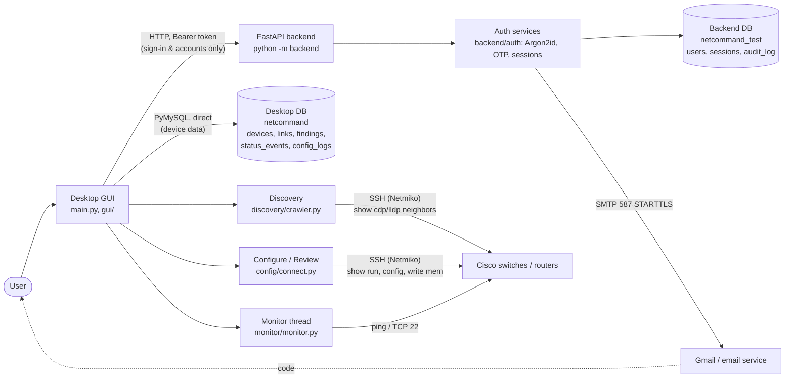
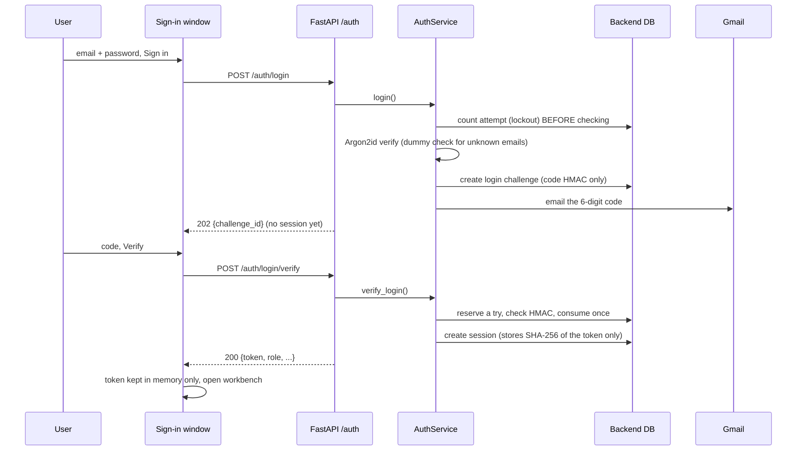
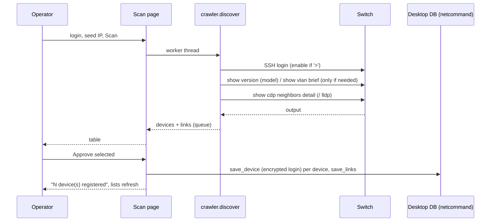
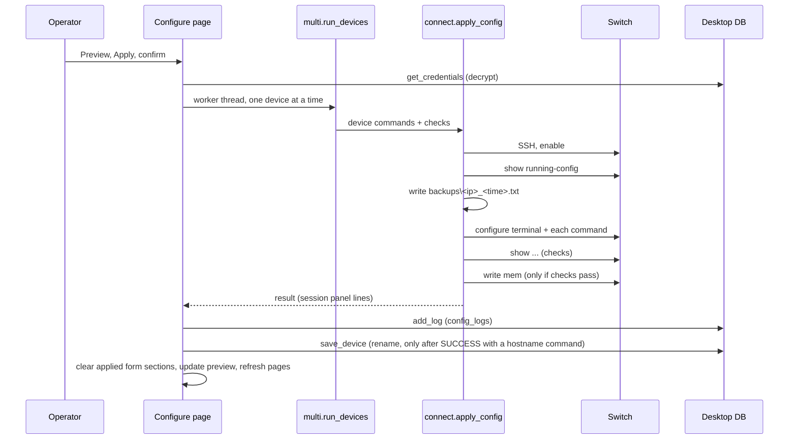
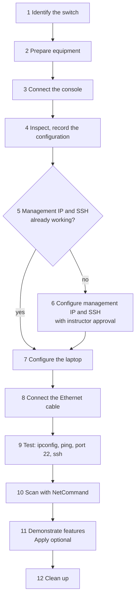
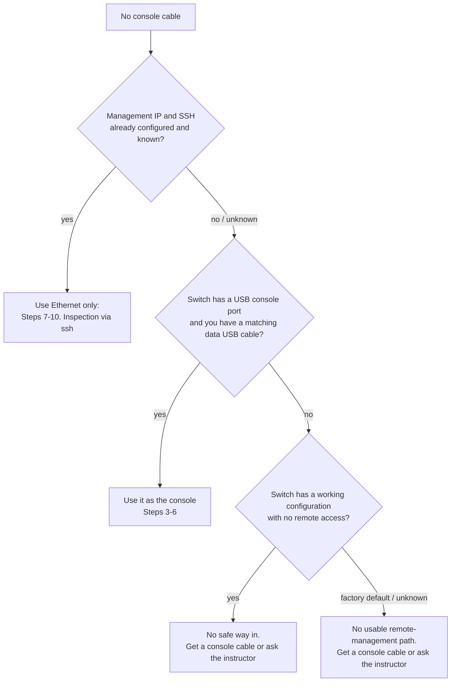

# NetCommand – Complete Guide

User manual, technical reference and Cisco switch demonstration guide for every member of
Group 5. It describes the code **as it is now** (November 2026). Planned work is marked
*planned* and is never described as existing.

> **Security rule for everyone:** never paste a real password, OTP code, session token,
> encryption key or `.env` line into chat, screenshots, slides, Git or this document. The
> examples here use placeholders such as `YOUR_PASSWORD`.

---

## Table of contents

1. [What NetCommand is](#1-what-netcommand-is)
2. [Architecture](#2-architecture)
3. [Installation and start-up](#3-installation-and-start-up)
4. [Accounts, sign-in and sessions](#4-accounts-sign-in-and-sessions)
5. [Roles and permissions](#5-roles-and-permissions)
6. [The desktop window, feature by feature](#6-the-desktop-window-feature-by-feature)
7. [What happens in the background](#7-what-happens-in-the-background)
8. [Preparing the real Cisco switch](#8-preparing-the-real-cisco-switch)
9. [Demonstrating NetCommand with the switch](#9-demonstrating-netcommand-with-the-switch)
10. [Safe and unsafe operations](#10-safe-and-unsafe-operations)
11. [Error reference](#11-error-reference)
12. [Administrator reference](#12-administrator-reference)
13. [Glossary](#13-glossary)
14. [Physical Cisco Switch Setup: From Unconfigured Switch to NetCommand](#14-physical-cisco-switch-setup-from-unconfigured-switch-to-netcommand)
15. [Demonstration-day checklists](#15-demonstration-day-checklists)

---

## 1. What NetCommand is

NetCommand is a Python desktop application (Tkinter/CustomTkinter) for small Cisco
networks. You plug a laptop into the network, type one device login, and NetCommand:

1. **finds** the switches and routers by logging in over SSH and reading their CDP or LLDP
   neighbor tables (Scan);
2. **registers** the ones you approve in a MySQL database (Devices);
3. **draws** the network map (Topology);
4. **reviews** their configurations for common security mistakes and suggests fixes
   (Findings);
5. **applies** configuration changes over SSH, always with a preview, a backup, a check and
   a log (Configure, Logs);
6. **watches** the registered devices in the background and records when one goes up or
   down (monitor, Status events).

People sign in with a NetCommand account (email, password and an emailed one-time code).
Accounts are handled by a separate **FastAPI backend** with its own database.

---

## 2. Architecture

### 2.1 The parts

| Part | What it is | Where in the code |
|---|---|---|
| Desktop GUI | The window you use. Tkinter + CustomTkinter. | `main.py`, `gui/` |
| Desktop data layer | Talks **directly** to MySQL for device data. | `db.py` (real), `db_fake.py` (sample/demo, in memory) |
| Device encryption | Encrypts saved device passwords (Fernet). | `security.py`, key `FERNET_KEY` in the root `.env` |
| Discovery | SSH crawler using CDP/LLDP. | `discovery/crawler.py`, `services.py` |
| SSH to devices | Netmiko (`device_type='cisco_ios'`). | `config/connect.py`, `config/multi.py`, `discovery/crawler.py` |
| Configuration builders | Turn the Configure forms into IOS commands. | `config/commands_switch.py`, `config/commands_router.py`, `config/interfaces.py` |
| Review rules | Find mistakes in running-configs. | `review/rules.py` |
| Topology | Graph layout and drawing. | `topology/graph.py`, `topology/layout_store.py`, `gui/topology_*.py` |
| Monitor | Background up/down checks. | `monitor/monitor.py` |
| Desktop sign-in | HTTP client + sign-in window + session. | `desktop_auth/`, `gui/auth_window.py`, `gui/session_watch.py`, `gui/accounts_page.py` |
| Backend API | FastAPI app: sign-in, sessions, accounts. | `backend/app.py`, `backend/api/auth_routes.py` |
| Backend services | Authentication rules, OTP, passwords, tokens. | `backend/auth/` |
| Backend email | SMTP (Gmail) or development outbox. | `backend/mail/` |
| Backend data | Account repository and migrations. | `backend/database/` |

### 2.2 Two databases on one MySQL server

| Database (default names) | Used by | Holds |
|---|---|---|
| `netcommand` | the **desktop** (`db.py`, account `netcommand_app`, root `.env`) | devices, links, findings, status events, configuration logs, encrypted device logins |
| `netcommand_test` | the **backend** (account `netcommand_api`, `backend/.env`) | NetCommand user accounts, email codes, sessions, audit log |

The names come from the two `.env` files; check yours with your administrator.
(A dedicated production database `netcommand_backend` is *planned*; only the safety checks
for it exist today.)

### 2.3 What goes through FastAPI and what does not

**Important:** only **sign-in and account administration** go through the FastAPI backend.
**Every device operation runs inside the desktop application**, which connects directly to
MySQL and directly to the devices over SSH.

| Operation | Path |
|---|---|
| Register, verify email, sign in, sign-in code, sign out, session check | Desktop → **FastAPI** → backend database (+ Gmail for codes) |
| Accounts page (list, approve, reject, disable, change role) | Desktop → **FastAPI** → backend database |
| Scan / discovery | Desktop → **SSH directly** to devices |
| Approve devices, add/edit/delete devices, links | Desktop → **MySQL directly** (`netcommand`) |
| Run review (reads configs) | Desktop → SSH to devices; findings → MySQL directly |
| Configure → Apply | Desktop → SSH to devices; result → MySQL directly (`config_logs`) |
| Monitor | Desktop → ping / TCP 22 to devices; changes → MySQL directly |
| Topology, Logs, Status events | Desktop → MySQL directly |

So for device features the role limits are applied **by the desktop program only** (an
"access gate", not a security boundary). Moving device operations behind the backend is
*planned*.

### 2.4 Architecture diagram



---

## 3. Installation and start-up

### 3.1 Required software

| Software | Version | Notes |
|---|---|---|
| Windows | 10 or 11 | The project is developed on Windows; commands below are PowerShell. |
| Python | 3.10 (the project venv uses **3.10.0**) | README allows 3.10–3.12. Tick "Add to PATH". |
| MySQL Community Server | 8.4 LTS | Listens on **127.0.0.1, port 3307** in this project. |
| Git | any | To get the code. |
| An SSH client (optional) | Windows OpenSSH | For testing the switch by hand. |
| A serial terminal (for the switch) | PuTTY or Tera Term | Needed for the switch's console port (Chapter 8). |

Python packages (installed into the venv):

* desktop (`requirements.txt`): `netmiko`, `pymysql`, `python-dotenv`, `cryptography`,
  `networkx`, `matplotlib`, `customtkinter==5.2.2`, `pytest` (tests only);
* backend (`backend/requirements.txt`): `fastapi`, `uvicorn`, `httpx`, `python-dotenv`,
  `argon2-cffi`, `argon2-cffi-bindings` (pinned versions).

### 3.2 Folder structure (main parts)

```
netcommand/
  main.py              desktop entry point
  db.py / db_fake.py   desktop data (MySQL / in-memory sample)
  security.py          device-password encryption (FERNET_KEY)
  services.py          glue: discovery, config fetch for the review
  validation.py        input checks (IPs, names, VLANs, ports)
  schema.sql           desktop database tables
  gui/                 every screen
  config/              IOS command builders, SSH apply
  discovery/           the SSH/CDP crawler
  review/              review rules
  topology/            map layout
  monitor/             background up/down checks
  desktop_auth/        desktop side of sign-in (API client, session)
  backend/             FastAPI backend (api/, auth/, mail/, database/)
  mock-lab/            simulated Cisco SSH devices for practice
  lab/lab_configs.txt  GNS3 lab configurations used earlier
  tests/               automated tests (offline)
  backups/             created on first Apply: running-config backups
```

### 3.3 One-time setup

From the project folder in PowerShell:

```powershell
python -m venv venv
.\venv\Scripts\python.exe -m pip install -r requirements.txt
.\venv\Scripts\python.exe -m pip install -r backend\requirements.txt
```

**Desktop settings – root `.env`** (copy `.env.example`; never commit `.env`):

| Setting | Meaning |
|---|---|
| `DB_HOST`, `DB_PORT`, `DB_USER`, `DB_PASSWORD`, `DB_NAME` | The desktop database (`127.0.0.1`, `3307`, `netcommand_app`, …, `netcommand`). |
| `FERNET_KEY` | Encrypts saved device logins. Create it with `python security.py --new-key` (written into `.env`, never shown). Everyone sharing a database needs the **same** key. |
| `NETCOMMAND_API_URL` | Where the backend is (default `http://127.0.0.1:8000`). A backend on another computer must use `https://`. |
| `NETCOMMAND_LEGACY_SSH_HOSTS` | Optional, not a secret. IPv4 addresses of older Cisco devices that only offer SHA-1 SSH algorithms (for example `192.168.10.1`). Empty = every device uses strict SSH. See 8.9. |

**Backend settings – `backend/.env`** (copy `backend/.env.example`; never commit it):

| Setting | Meaning |
|---|---|
| `BACKEND_DB_ENABLED=true`, `BACKEND_DB_HOST/PORT/NAME/USER/PASSWORD` | The backend database and its runtime account (`netcommand_api`). |
| `BACKEND_OTP_PEPPER` | Secret (32+ characters) used to protect the email codes. |
| `BACKEND_MAIL_BACKEND` | `smtp` (real email), `outbox` (development only: codes written to files) or `none`. |
| `BACKEND_SMTP_*` | Gmail: host `smtp.gmail.com`, port `587`, username, **app password**, sender. |
| `BACKEND_ENV` | `development`, `test` or `production`. |
| `BACKEND_AUTH_*` (optional) | Stricter limits only (see 4.7). |

The database tables are created by an administrator (Chapter 12): desktop tables with
`schema.sql`, backend tables with `python -m backend.database.migrate up ...`.

### 3.4 Starting NetCommand (normal use)

You need **two PowerShell windows**, both in the project folder.

**Window 1 – start the backend** (keep it open):

```powershell
.\venv\Scripts\python.exe -m backend
```

What happens: `backend/__main__.py` loads `backend/.env` (`backend/settings.py`); invalid
settings stop it with `NetCommand backend not started. Invalid backend settings: …` (names
only, never values). It then configures redacting logs and starts Uvicorn on
`http://127.0.0.1:8000`. The start-up log line shows `environment=…`, `database=enabled`,
`smtp=enabled`, `mail=smtp`, `otp_pepper=set` (never the values). **Nothing connects to
the database yet**; the account service is created on the first sign-in request.

Check it from Window 2:

```powershell
curl.exe -s http://127.0.0.1:8000/health      # {"status":"ok"}  (process alive, no DB)
curl.exe -s http://127.0.0.1:8000/ready       # {"status":"ready"} or 503 with a reason
```

`/ready` connects with the runtime account and checks `SELECT 1`, the migrations and the
four account tables (read-only). Reasons: `database_not_configured`,
`database_unavailable`, `schema_not_ready`.

**Window 2 – start the desktop app:**

```powershell
.\venv\Scripts\python.exe main.py
```

What happens (`main.py`):

1. Reads `NETCOMMAND_API_URL` (environment, else root `.env`, else
   `http://127.0.0.1:8000`) and checks it (plain `http` only for this computer).
2. Opens the **sign-in window** (talks to the backend only).
3. After a successful sign-in: connects to the **desktop database** (`db.ping()`); if it
   cannot, it starts in **SAMPLE mode** with a yellow banner explaining why.
4. Checks `FERNET_KEY`; if it is missing or invalid, it warns ("Encryption key problem")
   and keeps running, but device logins cannot be saved or used.
5. Starts the background **monitor** (unless `--no-monitor`).
6. Opens the workbench, showing only the pages your role may use.

Other start options:

```powershell
.\venv\Scripts\python.exe main.py --demo        # DEMO MODE: no sign-in, sample data in memory
.\venv\Scripts\python.exe main.py --no-monitor  # normal, without background pinging
```

### 3.5 Five different "connections" – do not confuse them

| Action | What it means | Needs |
|---|---|---|
| Starting the backend | The FastAPI process runs | `backend/.env` |
| Starting the desktop app | The window opens | root `.env` (API URL) |
| Authenticating a user | You prove who you are to the **backend** | NetCommand account + email code |
| Connecting to MySQL (desktop) | The desktop opens the **device** database | `DB_*` in root `.env` |
| Connecting to a Cisco switch | SSH to the device | the **device's** login (not your NetCommand account) |

Your NetCommand account and the switch login are completely separate.

### 3.6 Common start-up problems

| You see | Cause | Fix |
|---|---|---|
| `NetCommand backend not started. Invalid backend settings: BACKEND_… is required` | `backend/.env` incomplete | Fill in the named setting. |
| `/ready` → `database_unavailable` | MySQL off, wrong host/port, wrong `netcommand_api` password (MySQL error 1045) | Start MySQL; check `backend/.env`; administrator runs `migrate check-runtime-connection`. |
| `/ready` → `schema_not_ready` | Backend tables missing | Administrator runs the migrations. |
| Sign-in window: `The NetCommand server could not be reached. Check that it is running.` | Backend not started / wrong `NETCOMMAND_API_URL` | Start Window 1; check the URL. |
| `NETCOMMAND_API_URL must use https:// for a server on another computer …` | Plain http to another PC | Use the local backend or https. |
| Title shows `[sample mode: database unavailable at startup]` | Desktop MySQL not reachable at start | Start MySQL, check root `.env` `DB_*`, restart the app. |
| `Encryption key problem` warning | `FERNET_KEY` missing/invalid | `python security.py --check`; ask the person who has the group's key. |
| Sign-in gives `Sign-in is temporarily unavailable. Try again later.` | Backend can't use its DB, mail or settings | Check the backend console log; `/ready`. |

---

## 4. Accounts, sign-in and sessions

All of this goes through the backend. The desktop never checks passwords or codes itself.

### 4.1 The account life cycle

```
Create account → pending_verification → (email code) → pending_approval
               → (administrator approves) → active → (may be disabled or have its role changed)
```

Statuses: `pending_verification`, `pending_approval`, `active`, `rejected`, `disabled`.
Roles: `viewer` (default), `operator`, `admin`.
**Every account must verify its email address before it can be active or sign in.**

### 4.2 Registration

| Step | Details |
|---|---|
| 1. User action | Sign-in window → **Create account** → email, full name, password, confirm password → **Create account**. |
| 2. GUI | `gui/auth_window.py`, `SignInWindow.submit_register()`. Passwords that differ are refused locally (`The two passwords are not the same.`). Password fields are cleared at once. |
| 3. API | `POST /auth/register` `{email, full_name, password}` → **202**. |
| 4. Backend | `AuthService.register()` (`backend/auth/service.py`): checks the name and password policy (12+ characters, no control characters, not only spaces); rate limits; **hashes the password with Argon2id**; creates the user (`pending_verification`); generates a 6-digit code, stores only its **HMAC** (`email_challenges`); emails it (subject *NetCommand: verify your email address*). |
| 5. Tables | `users` (new row), `email_challenges` (new row), `audit_log` (`auth.register`, `auth.code_sent`). |
| 6. Expected result | Screen *Enter the verification code from your email* with: `If this email address can be registered, a verification code has been sent to it.` |
| 7. Errors | `The password must be at least 12 characters long.` · `The email address is not valid.` · `The email address must use plain ASCII characters.` · `Too many requests. Try again in N seconds.` · `The code could not be sent. Try again later.` (mail failure) |
| 8. Troubleshooting | No email? Check Spam; wait 60 s, use **Send a new code**. If the address is already registered, you get the **same** answer but **no** email (on purpose, so nobody can test which addresses exist). |

**Verify the email:** enter the code → `POST /auth/register/verify`
`{challenge_id, code}` → `verify_registration()` checks the code (5 tries, 5 minutes, one
use) → `users.status = pending_approval`, `email_verified_at` set → audit
`auth.email_verified`. Screen: *Email address verified. An administrator must approve your
account before you can sign in.* Wrong/expired/used code:
`The code is wrong, has expired or has already been used.`

**Lost the code / closed the window:** sign-in window → **Verify a new account** → email →
**Send code** (`POST /auth/register/resend`).

### 4.3 Administrator approval

| Step | Details |
|---|---|
| User action | Admin → **Accounts** page → filter `pending_approval` → select → **Approve as** (role) → **Approve**; or **Reject**; or **Disable** (asks for confirmation). |
| GUI | `gui/accounts_page.py` (`AccountsPage.approve/reject/disable`). |
| API | `GET /admin/users?status=…`, `POST /admin/users/{id}/approve` `{role?}`, `POST /admin/users/{id}/reject`, `POST /admin/users/{id}/disable`. |
| Backend | `AuthService.approve_account/reject_account/disable_account`: checks the caller's session **and** admin role on the server; approve works only for `pending_approval` accounts with a verified email; disable also ends all of the account's sessions and open codes; nobody can remove the last active admin. |
| Tables | `users` (status, approved_by, approved_at, role), `sessions` (revoked on disable), `audit_log` (`user.approved`, `user.status_changed`, `auth.sessions_revoked`). |
| Expected | `Approved: user@…` / `Rejected: …` / `Disabled: …` and the list refreshes. |
| Errors | `The account is not waiting for approval.` (409) · `The account does not exist or is already disabled.` · `This change would leave no active admin. Nothing was changed.` · `You do not have permission to do this.` (403, non-admin; audited as denied). |

The **first** administrator is created with a local command (Chapter 12), not through the
window.

### 4.4 Sign-in (two steps)



| Step | Details |
|---|---|
| User action | Email + password → **Sign in**; then the emailed code → **Verify**. |
| GUI | `SignInWindow.submit_login()` then `submit_login_code()`; the session is an `AuthSession` (`desktop_auth/session.py`). |
| API | `POST /auth/login` (202) → `POST /auth/login/verify` (200, token). Resend: `POST /auth/login/resend` `{challenge_id}`. |
| Backend | Rate limits; the attempt is counted **before** the password is checked (`begin_password_attempt`); unknown emails get the same Argon2 work; correct password + **active and email-verified** account → login code emailed (*NetCommand: your sign-in code*). Only after the right code is a **session** created. |
| Tables | `users` (failed_logins, locked_until), `email_challenges`, `sessions`, `audit_log` (`auth.login_password_ok`, `auth.code_sent`, `auth.login`, failures). |
| Expected | Code screen, then the workbench; header shows `your@email · Role` and **Sign out**. |
| Errors | `The email address or password is incorrect, or the account is locked.` (same text for unknown email, wrong password, locked) · `This account cannot sign in: it is waiting for email verification or administrator approval, or it has been disabled.` · code errors as above · `Too many requests. Try again in N seconds.` |
| Lockout | 5 wrong passwords in a row → locked 15 minutes (`auth.account_locked`). |

### 4.5 The session token

* Returned **once** by `/auth/login/verify`; the backend stores only its SHA-256.
* The desktop keeps it in memory only (never in a file, the database, settings, logs or
  environment variables) and sends it as `Authorization: Bearer …`.
* Signing out (`POST /auth/logout`) or closing the window ends it on the server.

### 4.6 Session rules and what you see

| Situation | Rule | What happens |
|---|---|---|
| Idle | 30 minutes without a key press or click | Desktop signs you out: `You were signed out after 30 minutes without activity.` |
| Absolute limit | 8 hours | `Your session has reached its time limit. Sign in again.` |
| Revoked / disabled / expired on the server | Checked by `GET /auth/session` about once a minute while you are active | `Your session has ended (it was signed out elsewhere, expired, or the account was disabled). Sign in again.` |
| Role changed by an admin | Detected on the next check; the role change also ends all sessions | `Your account permissions have changed. Sign in again.` |
| Backend unreachable during a check | The session is **not** ended; checked again later | (nothing shown) |
| Invalid/missing token on any API call | `401 {"error":"not_authenticated","detail":"Sign in again."}` | Desktop returns to the sign-in window. |

### 4.7 Security policy (defaults)

| Item | Value |
|---|---|
| Password | 12–128 characters, Argon2id |
| Lockout | 5 failures → 15 minutes |
| Codes | 6 digits, 5 minutes, 5 tries, one use; new code at most every 60 s, 5 per hour |
| Session | 8 hours maximum, 30 minutes idle |
| Rate limits | per email and per IP (unknown emails included); API-wide 120 requests/minute per IP |

### 4.8 Backend endpoints

| Method and path | Who | Purpose |
|---|---|---|
| `GET /health` | anyone | Process alive (no DB) |
| `GET /ready` | anyone | Database ready (read-only) |
| `POST /auth/register` | anyone | Create account, email code |
| `POST /auth/register/verify` | anyone | Verify registration code |
| `POST /auth/register/resend` | anyone | New registration code |
| `POST /auth/login` | anyone | Password step, email login code |
| `POST /auth/login/verify` | anyone | Code step → session token |
| `POST /auth/login/resend` | anyone with the open login challenge | New login code |
| `POST /auth/logout` | signed in | End session (204) |
| `GET /auth/session` | signed in | Who am I (user_id, role) |
| `GET /admin/users` | admin | List accounts |
| `POST /admin/users/{id}/approve` | admin | Approve (optional role) |
| `POST /admin/users/{id}/reject` | admin | Reject |
| `POST /admin/users/{id}/disable` | admin | Disable + end sessions |
| `POST /admin/users/{id}/role` | admin | Change role (never your own; never the last admin) |

Error body: `{"detail": "<message>", "error": "<code>"}` with codes `invalid_request`,
`code_invalid` (400), `login_failed`, `not_authenticated` (401), `account_not_active`,
`not_permitted` (403), `no_change` (409), `too_large` (413), `rate_limited` (429 +
`Retry-After`), `delivery_failed`, `unavailable` (503).

---

## 5. Roles and permissions

| Capability | Viewer | Operator | Admin | Enforced by |
|---|---|---|---|---|
| Sign in, see own session | ✓ | ✓ | ✓ | Backend |
| Accounts page: list, approve, reject, disable, change role | – | – | ✓ | **Backend** (and the GUI shows the page only to admins) |
| Overview, Topology, Logs, Console/Config log/Status events | ✓ | ✓ | ✓ | GUI |
| Devices page: view, search, sort | ✓ | ✓ | ✓ | GUI |
| Devices page: Add / Edit / Delete / Restore, save device logins | – | ✓ | ✓ | **GUI only** |
| Scan / discovery and Approve devices | – | ✓ | ✓ | **GUI only** (page hidden for viewers) |
| Findings: Show stored review | ✓ | ✓ | ✓ | GUI |
| Findings: Run review, Send to Configure | – | ✓ | ✓ | **GUI only** |
| Configure (Preview, Apply, SSH session log) | – | ✓ | ✓ | **GUI only** (page hidden) |
| Monitor | runs for every signed-in role | | | (system activity) |
| Demo mode (`--demo`) | no sign-in; sample data | | | — |

**When you are not allowed:**

* GUI-only items: the page is not in the side rail, buttons are disabled, and asking for it
  another way (command strip, inspector "Configure") writes in the Console:
  `Your role (Viewer) cannot use Configure.`
* Backend items: the server answers `403 not_permitted` (`You do not have permission to do
  this.`) and writes a "denied" audit record.

> Because device data goes straight from the desktop to MySQL, the GUI-only rows are **not**
> protected against someone who has the desktop `.env` (database password and `FERNET_KEY`).
> Moving these operations behind the backend is *planned*.

---

## 6. The desktop window, feature by feature

### 6.0 The workbench layout

```
+----+--------------------------------------------------+-----------------+
| NC | NetCommand  [ command strip: find / operate ]  user · Role  Sign out |
+----+--------------------------------------------------+-----------------+
| R  |  page area (selected page)                       |  Inspector      |
| a  +--------------------------------------------------+-----------------+
| i  |  Console | Config log | Status events                               |
| l  |                                                                     |
+----+---------------------------------------------------------------------+
| status bar: N registered devices        Ctrl+K command strip  Hide inspector |
+--------------------------------------------------------------------------+
```

* **Rail** (left): Overview, Scan, Devices, Topology, Findings, Configure, Logs, and
  Accounts (admins). Viewers do not see Scan or Configure.
* **Header source label**: `database connected`, `database unavailable`, `sample mode · in
  memory`; in demo mode `DEMO MODE · not signed in` in red.
* **Yellow outage bar**: appears if the desktop database stops answering, with **Retry now**.

### 6.1 Sign-in window

**Purpose:** sign in, create an account, verify a new account.
**How to access:** shown at start (not in `--demo`).
**Screens:** `login`, `login_code`, `register`, `register_code`, `register_resend`.
**Background:** `gui/auth_window.py` → `desktop_auth/api_client.py` → backend `/auth/*`
(Chapter 4). No database access from the desktop here.
**Errors:** server messages are shown in red; `The NetCommand server could not be reached.
Check that it is running.`; `The NetCommand server sent an unexpected answer.`;
`Something went wrong. Try again.`
**Permissions:** everyone. **Safety:** account data only.

### 6.2 Overview

**Purpose:** home page: a summary of the stored network data.
**How to access:** rail → **Overview** (the page shown after sign-in). Every role sees it.
**What it shows** (`gui/overview_page.py`), all read from the database (or the in-memory
store in sample mode); nothing is estimated:

| Part | Content | Source |
|---|---|---|
| **DEVICES** card | Registered devices; routers · switches · unknown; how many are managed | `devices` |
| **STATUS (LAST KNOWN)** card | `●  N online    ■  N offline`, as last recorded by the background monitor | `devices.status` |
| **FINDINGS** card | Findings of the stored review: high · medium · low, and when the review ran (findings of deleted devices are not counted) | `findings` |
| **CONFIGURATION CHANGES** card | Every Apply: successful · failed | `config_logs` |
| **RECENT SCAN ACTIVITY** | This session's scans and approvals, plus the devices most recently registered | Scan page (memory) + `devices` |
| **RECENT CONFIGURATION ACTIVITY** | The newest Apply results (failed ones in red) | `config_logs` |
| **RECENT STATUS CHANGES** | The newest up/down changes, for example `up → down` | `status_events` |
| **QUICK ACTIONS** | Buttons for Scan network, Devices, Open Topology, Findings, Configure, Logs – only the pages your role may open | – |

**Refreshing:** the page reloads when you open it and its data is older than 15 seconds,
straight after a scan approval, a device edit, an Apply or a saved review, every 60
seconds while it is on screen, and whenever you click **Refresh** (the header shows
`Updated hh:mm:ss`).
**Notes:** a scan that was not approved is not stored in the database, so *Recent scan
activity* lists this session's scans only (registered devices come from the database). A
newly registered device shows its saved status until the monitor first checks it.
**Empty states:** with no data, each card and list says so and what to do next (for example
`No devices registered yet.` / `No configuration changes recorded yet.`).
**Errors:** when the database cannot be read, a red banner
`Overview unavailable: … Click Refresh to try again.` replaces the figures with `—` (old
figures are never shown as current). During a known database outage the page makes no
automatic queries; it reloads by itself when the connection is back.
**Permissions:** everyone. **Safety:** read-only.

### 6.3 Scan (discovery)

**Purpose:** find switches/routers by SSH + CDP/LLDP and register them.
**How to access:** rail → **Scan** (operators, admins).
**User procedure:**
1. Type the **device** login (Username, Password) – the switch's SSH login, not your
   NetCommand account.
2. Type **Seed IP**: the management IP of the switch or router to log in to. It is
   **required** for a real scan; NetCommand never guesses it (there is no default-gateway
   fallback).
3. Leave *Demo mode* unticked for a real scan. Keep *Save the login (encrypted) with
   approved devices* ticked if you want Configure/Review to use it later.
4. Leave *Also log in to CDP/LLDP neighbours with this login* **unticked** (the default),
   unless you really want the login sent to every neighbour (see below).
5. **Scan**. Status: `Scanning... this can take a minute.`
6. Review the table (Name, IP, Type, Managed, Source), select rows, **Approve selected**.

**Background processing (seed-only by default):**
* `ScanTab.on_scan()` → worker thread `run_scan()` → `services.run_discovery()` →
  `discovery/crawler.discover()`.
* The login is sent **only to the Seed IP**: Netmiko
  `ConnectHandler(device_type='cisco_ios', secret=<same password>)`, with the SSH options
  from `ssh_options.py` (strict by default, see 8.9); if the prompt ends in `>`, it runs
  `enable` with the same password.
* Commands sent to the seed (read-only): `show version` (model and software, to decide
  router or switch – see *How NetCommand decides the device type* below), `show vlan
  brief` only when the model is not recognised, `show cdp neighbors detail`, and if that is
  empty `show lldp neighbors detail`.
* Every CDP/LLDP neighbour with a management IP is **listed as unmanaged** (name, IP and
  type from the neighbour table) together with its link to the seed. NetCommand does
  **not** log in to it.
* If the seed login fails, the scan stops and says why. **Nothing else is tried**: no
  other hosts from the laptop's ARP table, no default gateway, no neighbours.
* **Optional – *Also log in to CDP/LLDP neighbours with this login*** (off by default):
  NetCommand asks for confirmation (*Log in to neighbours?*), then also logs in to every
  neighbour with a management IP using the **same username and password** (breadth-first,
  max 64 devices, one attempt each, never guessed passwords). The login is therefore sent
  to all of those devices. Use it only on a network you control where every device is
  expected to use this login. Neighbours that refuse it stay unmanaged.
* **Approve** → `ScanTab.approve()` → for each device `store.save_device()` (one
  transaction per device; the login is encrypted with `FERNET_KEY`), then
  `store.save_links()` → MySQL `devices`, `links` (direct, desktop DB). The scan login is
  saved only for **managed** devices (those NetCommand logged in to).

**Expected result:** `Found N devices (M managed) and K links. Select the ones to register
and click Approve.` → after approval: `N device(s) registered.` (exact text: `1 device registered.` / `3 devices registered.`) and they appear under
Devices. A single switch alone gives **1 device, 0 links** (laptops do not speak CDP). A
seed with three CDP neighbours gives 4 devices (1 managed) and 3 links.

**Possible errors** (the reason in `Scan failed` messages comes from `ssh_options.py`; it is
fixed text and never contains a password):

| Message | Cause | Solution |
|---|---|---|
| `Login needed` – `Enter the username and password.` | Fields empty | Type the device login. |
| `Seed IP needed` – `Type the management IP address of the switch or router to log in to. …` | Seed IP empty | Type the device's management IP. |
| `Seed IP` – `Enter a valid IPv4 address, like 192.168.1.10` | Bad IP | Fix it. |
| `Scan failed` – `Could not log in to the starting device X: the device rejected the username or password.` | Wrong device login | Check `username`/`secret` on the device. |
| `Scan failed` – `… the device offers only old SSH algorithms (SHA-1 key exchange or an ssh-rsa host key), which NetCommand refuses by default. …` | Older IOS (e.g. Cisco 1900) | If you control the device, add its IP to `NETCOMMAND_LEGACY_SSH_HOSTS` (8.9) and restart NetCommand. |
| `Scan failed` – `… the device and NetCommand have no SSH algorithm in common, even with legacy SSH allowed for this address.` | The device offers only algorithms refused for everyone (e.g. only `diffie-hellman-group1-sha1`) | Not fixable in NetCommand; ask the instructor about the device's SSH settings. |
| `Scan failed` – `… the connection to port 22 was refused (SSH is not enabled on the device, or it is blocked).` | SSH off or blocked | Chapter 8 (SSH setup), `show ip ssh`. |
| `Scan failed` – `… no answer (the connection timed out: is the IP right, is the device on, is it reachable?)` | No IP path | Chapter 8 checks (ping, port 22). |
| `Scan failed` – `… SSH error (ClassName).` | Another SSH problem | Try the manual `ssh` test (8.8). |
| `Log in to neighbours?` (question) | The neighbour option is ticked | **No** cancels the scan (nothing is contacted); **Yes** sends the login to the neighbours. |
| `Sample devices` – `These are sample devices. They can only be approved in sample mode …` | Demo results with the real DB | Untick Demo mode and scan the real network. |
| `Could not save` – `Nothing was saved. …` / partial save details | Database problem or duplicate name | Read the list of saved/failed devices; fix and approve again. |
| `Deleted devices found` dialog | A found IP belongs to a deleted device | Tick to restore (choose keep/use scan login) or leave it deleted. |

#### How NetCommand decides the device type (router, switch or unknown)

The **Type** column matters: Configure sends *Router settings* only to devices of type
`router` and *Switch settings* only to type `switch`. NetCommand decides the type of the
device it logged in to (`discovery/crawler.py`, `classify()`) in this order:

| Step | What is checked | Result |
|---|---|---|
| 1 | The **model / software image** in `show version` | A known **switch** family → `switch`. Otherwise a known **router** family → `router`. |
| 2 | Only if step 1 found no known model: `show vlan brief` | A real VLAN table (`1  default  active …`) → `switch`. The device rejects the command (`% Invalid …`, `% Ambiguous …`, `% Unknown command`, `% Incomplete`) → `router` (every Cisco switch has this command; routers have no VLAN table). |
| 3 | Nothing conclusive (no known model, the command failed or timed out, an unclear answer) | `unknown` – NetCommand never guesses `switch`. |

Families NetCommand recognises (examples of what `show version` prints):

| Type | Families | Example text |
|---|---|---|
| router | ISR 1800 / 1900 / 2800 / 2900 / 3800 / 3900, ISR 4000, ISR 1100, C800, 7200/7600, ASR, CSR1000V, ISRv, GNS3 IOSv router image | `C1900 Software (C1900-UNIVERSALK9-M)`, `Cisco CISCO1941/K9 (revision 1.0)`, `cisco ISR4331/K9`, `VIOS-ADVENTERPRISEK9-M` |
| switch | `WS-C…` models, Catalyst 2918/2940/2948/2950/2955/2960/2970/2975, 3550/3560/3650/3750/3850, 4500/6500/6800, 9200–9600, Catalyst 1000, CAT3K/CAT9K images, Industrial Ethernet (IE), GNS3 vios_l2 | `cisco WS-C2960-24TT-L`, `C2960 Software (C2960-LANBASEK9-M)`, `cisco C9300-24T`, `vios_l2 Software` |

Switch families are checked first, because some numbers look alike (a Catalyst **2960**
switch versus a **2900**-series router).

**Neighbours** (listed from CDP/LLDP, not logged in to) get their type from the neighbour
table in the same spirit: first the CDP `Platform:` line or the LLDP `System Description`
(for example `Cisco CISCO1941/K9` → router), and only if that names no known family, the
advertised capabilities. This matters because many routers also announce a "Switch"
capability.

**If the type is wrong or `unknown`:** correct it on the Devices page (6.4, *Correcting a
device's name or type*). Configure refuses to send settings to an `unknown` device and
says, for example: `its type is "unknown"; set it to switch or router on the Devices page
before sending router settings`. A device registered **before** this classification
existed keeps its old type until you correct it.

**Permissions:** operators, admins (GUI-only). **Safety:** scanning is **read-only** on the
devices; approving writes to the desktop database.

### 6.4 Devices

**Purpose:** the list of registered devices.
**How to access:** rail → **Devices**.
**Procedure:** Search box (name/IP), click column headers to sort, **Previous/Next** pages
(15 per page). **Add** / **Edit** (or double-click) open *Add device / Edit device*: Name,
IP address, Type (switch/router/unknown), Status (up/down), *Managed (we can log in)*,
Login username, Login password (*Optional. Saved encrypted, used by Configure and Review.*;
when editing: *Leave both blank to keep the current login.*). **Delete** asks
`Delete NAME (IP)?` and is a **soft delete** (history kept; restorable).
**Background:** `gui/devices_tab.py` → `db.save_device / update_device / delete_device /
restore_device` → MySQL `devices` (direct). Passwords encrypted by `security.encrypt`.
**Errors:** `Select a device` – `Click a device in the list first.`; `Cannot save` with the
validation message (`The name can only use letters, numbers, dots, dashes, and
underscores.`, `Enter a valid IPv4 address, like 192.168.1.10`); `Name already used`;
a deleted device with the same IP opens a restore dialog (keep or replace its login);
`Device gone` – `This device is no longer registered.`; database outage →
`The database is not available, so this cannot be done now. Nothing was changed. …`
**Permissions:** everyone can view; Add/Edit/Delete for operators and admins (GUI-only).
**Safety:** database only; nothing is sent to devices.

**When the list refreshes:** every time you open the Devices page, and automatically after
Add, Edit, Delete, a Scan approval, and a Configure **Apply that renamed a device** (6.7,
*After Apply*). The list always reads the database, so it shows the stored name and type.

#### Correcting a device's name or type

Use this when a device shows a wrong or old name, or a wrong type (for example a router
registered as `switch` before the improved classification, or a device marked `unknown`).

1. Rail → **Devices**, click the device, then **Edit** (or double-click the row).
2. In *Edit device*:
   * **Name** – letters, numbers, dots, dashes and underscores only; no other registered
     device may use the same name (capital letters do not make a name different).
   * **Type** – choose `switch`, `router` or `unknown` from the list.
   * Leave **Login username** and **Login password** empty to keep the saved login.
3. **Save**.

What is kept: Edit changes the **same device record** (the same database id), so its
configuration history (Logs), findings and status events stay attached; its saved
**links** are renamed to the new name in the same save; and the saved login is unchanged.
Nothing is sent to the device – this only changes NetCommand's records. To change the
real hostname on the router, use Configure (6.7); a successful hostname Apply also renames
the record automatically.

Possible messages: `Name already used` – `Nothing was saved. …` (choose another name;
the dialog stays open); `Cannot save` with the name or IP rule that was broken.

### 6.5 Topology

**Purpose:** the network map from registered devices and links.
**How to access:** rail → **Topology**.
**Procedure:** **Refresh map**; **View**: *Interactive* (click a device or link to inspect
it, drag devices, drag empty space to pan, mouse wheel to zoom) or *Static image*
(Matplotlib). **Save layout** / **Reset layout** keep device positions.
**Background:** `gui/topology_tab.py`, `gui/topology_canvas.py`, `topology/graph.py`
(layout with NetworkX; single points of failure are computed as articulation points).
Positions are saved per data source in `%APPDATA%\NetCommand\topology_layout.json`.
**Expected:** devices with names and interface labels. Markers: filled dot = up, hollow
square = down, hollow dot = unmanaged; rounded shape = router. Single points of failure are
noted. With no registered devices in database mode it says so (it never
shows sample devices as yours).
**Errors:** `Save layout` – `There is no network on the map to save.`; `Map failed` with a
reason. **Permissions:** everyone. **Safety:** read-only (layout file is local only).

### 6.6 Findings (configuration review)

**Purpose:** check device configs for common mistakes and give fixes plus a health score.
**How to access:** rail → **Findings**.
**Procedure:** opening the page shows the **stored review**. **Run review** reads every
managed device's running-config and replaces the stored review. Click a finding to see the
suggested commands; **Send to Configure** copies them into Configure's preview.
**Background:** `findings_tab.run()` → worker → `services.collect_review_inputs()` →
`fetch_configs()`: for each managed device with a saved login, decrypt it
(`db.get_credentials`) and SSH `show running-config` (`config/connect.get_config`) →
`review/rules.review_network()` → `db.replace_findings()` (one transaction: all or
nothing).

Rules (`review/rules.py`):

| Rule | Severity | Triggered when | Suggested fix |
|---|---|---|---|
| `telnet_enabled` | high | `transport input all` or `transport input telnet` | `line vty 0 4` / `transport input ssh` |
| `no_password_encryption` | medium | `service password-encryption` is not on | `service password-encryption` |
| `no_port_security` | medium | an interface has `switchport mode access` but no port security | port-security max 2, violation shutdown |
| `trunk_all_vlans` | medium | a trunk with no `switchport trunk allowed vlan` | allowed-VLAN list (edit `10,20,30`!) |
| `single_point_of_failure` | medium | a device whose failure splits the map | add a second uplink (no commands) |

Health score = 100 − 15 per high − 8 per medium − 3 per low (minimum 0).

Notes on two suggested fixes:

* `service password-encryption` only turns plain-text `password` lines into **Type 7**, a
  reversible obfuscation that is easy to decode. It is not strong protection; use `secret`
  for users and `enable` (8.6).
* `no_port_security` is reported for **every** access port, including the port the laptop
  uses. Applying that fix (`violation shutdown`) to the laptop's port can cut your own
  connection.

**Errors:** devices skipped with notes (`no saved login, skipped`, `saved login could not be
decrypted … skipped`, and an SSH reason such as `R1: the device offers only old SSH algorithms …,
skipped` or `SW1: no answer (the connection timed out: …), skipped`); `Review failed` with the reason;
`Needs cabling` for single points of failure. **Permissions:** everyone sees the stored
review; Run review and Send to Configure: operators, admins (GUI-only).
**Safety:** reading configs is read-only on devices; the stored review in the database is
replaced.

### 6.7 Configure

**Purpose:** change device configuration safely.
**How to access:** rail → **Configure**, or Findings → Send to Configure, or the
inspector's **Configure** button.
**Layout:** Devices (tick one or more managed devices) | Settings | Preview + SSH session.

* **Switch settings**: *VLANs & access* (VLAN id 2–4094, not 1002–1005; name without
  spaces; access ports such as `Fa0/1-5`), *Trunks* (ports, allowed VLANs, native VLAN,
  optional `switchport trunk encapsulation dot1q`), *Port security* (maximum, violation,
  sticky), *Interfaces* (description, shutdown / no shutdown).
* **Router settings**: *Basics* (hostname, default route, DNS, NTP), *DHCP*, *Interfaces*
  (IP/mask/description/state), *Static routes*.

**Procedure:** tick devices → fill settings → **Preview** (one section per device; skipped
devices with the reason; the text can be edited by hand) → **Apply** → confirm. Option:
*Stop at the first device that fails*.

**Background:** `ConfigureTab.apply()` → logins from the database (decrypted); devices
without a usable saved login → the **SSH login dialog** (see *SSH login dialog* below) →
worker thread → `config/multi.run_devices()` → for each device
`config/connect.apply_config()`:

1. **CONNECT** – SSH, `enable` if needed.
2. **BACKUP** – `show running-config`, saved to `backups\<ip>_<date>_<time>.txt`.
3. **CONFIGURATION** – `configure terminal`, one command at a time; stops at the first
   command the device rejects (`% Invalid …`).
4. **VERIFICATION** – `show …` checks (e.g. `show vlan brief` must contain the VLAN name).
5. **SAVE** – `write mem` **only if all checks passed**.
6. Result → `db.add_log()` → `config_logs` (success/failed) → Logs page.

The **SSH session panel** shows every real command and reply (passwords masked).
**Expected:** `SUCCESS: N command(s) applied, verified and saved. Backup: …`.
**Errors:** `Select a device` – `Tick at least one managed device first.`;
`Nothing to preview`; `Cannot apply`; `Apply cancelled: no login was entered. Nothing was
sent.` (the login dialog was cancelled); `SSH login refused` (retry question, see below);
per device: `No answer (the connection timed out: wrong IP, device off, or not reachable).`,
`Connection refused (SSH is not enabled on the device, or port 22 is blocked).`,
`Unsupported SSH algorithms: …` (see 8.9), `Wrong username or password.`, `The device rejected a command: "…" (…). The change is
partially applied …, and it was not saved. Restore from the backup if needed: …`,
`Check failed: "…" was not found in …. The commands were applied but not saved.`;
summary dialog `Some devices were not configured`.
**Permissions:** operators, admins (GUI-only).
**Safety: CHANGES THE DEVICE** – running-config and, on success, startup-config
(`write mem` saves the **whole** running-config, not only these commands). The backup is
**not** an automatic rollback: NetCommand never restores it, and if a later command is
rejected, the commands before it stay in the running-config (partially applied, not
saved). See Chapter 10.

#### SSH login dialog

When a ticked device has no saved login, or its saved login cannot be decrypted (the
`FERNET_KEY` changed), Apply opens one **SSH login needed** dialog
(`gui/components/login_dialog.py`) before anything is sent:

* It is a modal window centered over NetCommand; the main window waits until it is closed.
* It says why a login is needed, for example `NetCommand has no saved SSH login for R1
  (192.168.10.1).` or `The saved SSH login for R1 (…) cannot be read (the encryption key may
  have changed), so NetCommand needs the login again.` With several devices, one login is
  used for all of them.
* **Username** and **Password** (masked). This is the device's SSH login, not your
  NetCommand account.
* **Save this login for future use (stored encrypted)** – off by default. Off: the login is
  used for this Apply only (`Not saved: used for this Apply only.`). On: it is saved **only
  after the device accepted it**, encrypted with `FERNET_KEY` through the same save as the
  Devices page; the console then shows `R1: SSH login saved (encrypted) for future use.`
  If an existing saved login would be overwritten, the checkbox reads *Replace the saved
  login with this one* and NetCommand asks `Replace the saved login?` first.
* **Use this login** (or Enter) continues; **Cancel** (or Escape) cancels the whole Apply:
  nothing is sent to any device.

**Refused login:** if a device refuses the login (`Wrong username or password.`), nothing
was changed on it and NetCommand asks `SSH login refused` – *Enter the login again and
retry?* **Yes** opens the dialog again for those devices only and retries them; **No**
leaves everything as it is (the console notes that the login was refused and not
retried). A login that was refused is never saved. The password is never shown, logged or
written to the console, the session panel or the Logs.

#### After Apply: what NetCommand updates and clears

Each device's result is one of: **SUCCESS** (applied, verified and saved), **PARTIALLY
APPLIED**, **APPLIED, NOT VERIFIED** (applied, but a check failed; not saved), **FAILED**
or **NOT RUN**. Only **SUCCESS** counts as "done" below.

**1. A new hostname renames the device record.** When a device reports SUCCESS and one of
the commands it received was `hostname NEW-NAME` (from *Router settings → Basics →
Hostname*, or typed into the preview by hand), NetCommand renames **that same device
record** to `NEW-NAME`:

* no new record is created (no duplicate); the record keeps its id, IP, type, status and
  saved login;
* its saved links are renamed with it, and its findings, status events and configuration
  history (Logs) stay attached;
* the console shows, for example, `R1 is now BRANCH-RTR (hostname applied; same device
  record, links and history kept).`

The record is **not** renamed when the Apply did not fully succeed (even if the hostname
command itself was accepted), when another registered device already uses that name, or
when the name breaks the device-name rules. The console then explains why, for example
`R1: the hostname is now SW1, but another registered device already uses that name. The
device list keeps the name R1; you can rename it on the Devices page.`

**2. The other pages refresh.** After a rename, the Devices page, Configure's own device
list, the inspector and the status bar are refreshed at once, so the new name appears
without restarting.

**3. Applied form sections are cleared.** Preview remembers which **sections** of the form
it was built from, and their values. The sections are:

| Form | Sections (as named in the preview's first line) |
|---|---|
| Router settings | `Hostname`, `Default route`, `DNS servers`, `NTP` (Basics fields), `DHCP` (all DHCP fields, including the excluded range), `Interfaces` (router interface list), `Static routes` |
| Switch settings | `VLANs`, `Access ports` (both on *VLANs & access*), `Trunk ports`, `Port security`, `Interface settings` |

After a **fully successful** Apply, a section is cleared only when **all** of these are true:

* every device the preview was built for reports SUCCESS;
* the preview was **not edited by hand** for those devices (otherwise the commands that ran
  may differ from the form);
* the section's fields still contain the **same values** as when you clicked Preview.

So: fill DHCP → Preview → Apply succeeds → the DHCP fields are empty, and the next Preview
(for example a new hostname) contains only the new change. A field you filled in **after**
clicking Preview is not part of the applied change and is kept. The other form (switch vs
router) is never touched. Values typed into a list's entry boxes but not added with
**Add** are not part of any preview and are kept.

**4. The preview shows only what is still pending.**

| Outcome | Form fields | Preview |
|---|---|---|
| All devices SUCCESS, preview not edited | Applied sections cleared | Replaced by `# Applied and saved: R1. Cleared from the form: DHCP.` and `# Fill in new settings and click Preview.` |
| All devices SUCCESS, preview edited by hand | **Kept** | Replaced by the *Applied and saved* note (nothing left to send) |
| Some devices SUCCESS, others not (several devices) | **Kept** (the others still need them) | The succeeded devices' sections are removed; the first line says `# Applied and saved (removed below): … The sections left are still pending.` |
| FAILED, PARTIALLY APPLIED, APPLIED NOT VERIFIED or NOT RUN | **Kept** | **Kept** unchanged, so you can correct and retry |

After a failure, read the SSH session panel first: a **partially applied** or **not
verified** change may already be active on the device (not saved). Retrying sends the
whole section again; check the result with the device's `show` commands.

### 6.8 SSH session panel (inside Configure)

It is a **read-only log**, not an interactive terminal: you cannot type commands into it.
It shows what Apply sends and what the device answers, kept until **Clear console**.

### 6.9 Logs

**Purpose:** every configuration attempt (success or failed).
**How to access:** rail → **Logs**; also the console's *Config log* tab.
**Procedure:** Search, Status filter (`all`, `success`, `failed`), Refresh, Previous/Next
(15 per page).
**Background:** `db.get_logs()` from `config_logs` (direct). **Safety:** read-only.

### 6.10 Console, Config log, Status events (bottom panel)

* **Console** – this session's events (scan results, approvals, applies, access refusals).
* **Config log** – the stored configuration log.
* **Status events** – device up/down changes recorded by the monitor.

### 6.11 Monitoring (background)

**Purpose:** mark devices up/down. **How:** automatic after sign-in (not in demo mode, not
with `--no-monitor`). Every **30 seconds** each registered device is checked: `ping`, and
if that fails, a TCP connection to port 22. A device must fail **twice in a row** to be
marked down. Changes are saved with an event (`devices.status` + `status_events`, one
transaction) and appear in *Status events*. **Safety:** read-only towards devices; writes
status to the desktop database. Note: every open desktop window runs its own monitor.

### 6.12 Command strip and inspector

* **Command strip** (top, `Ctrl+K`): type part of a device name/IP to select it, or an
  operation word (`scan`, `devices`, `topology`/`map`, `findings`/`review`,
  `configure [device]`, `logs`, `overview`). It only opens pages.
* **Inspector** (right): details of the selected device or link from the database (never
  the saved login). Buttons: *Configure NAME* (refused for viewers) and *Show in Devices*;
  an unmanaged device shows `Not managed: NetCommand cannot log in to configure it.`

### 6.13 Accounts (admins)

**Purpose:** manage NetCommand accounts. **Procedure:** *Show* filter
(pending_approval/all/…), **Refresh**, select a row; **Approve as** role → **Approve**;
**Reject** / **Disable** (confirmations); **Change role to** → **Change role** (confirmation:
the account is signed out everywhere). Your own role cannot be changed here.
**Background:** API calls (Chapter 4.3, 4.8). **Permissions:** admins, enforced by the
backend. **Safety:** account data only.

### 6.14 Demo mode

`main.py --demo`: no sign-in, data in memory (`db_fake`), header `DEMO MODE · not signed
in`, no monitor. The Scan page's *Demo mode* box loads sample devices (CORE, SW1, SW2, R1,
AP-1). Caution: in demo mode an unticked *Demo mode* box and Configure can still reach
**real** devices with logins you type.

---

## 7. What happens in the background

### 7.1 Registration and approval

```
Create account → POST /auth/register → AuthService.register → Argon2id hash
 → users(pending_verification) → email_challenges(HMAC) → SMTP email
Code → POST /auth/register/verify → reserve try → HMAC compare → consume once
 → users(pending_approval, email_verified_at) → audit
Admin Approve → POST /admin/users/{id}/approve → authorize(admin) → users(active) → audit
```

### 7.2 Sign-in and session

See the sequence diagram in 4.4. Session checks: desktop `SessionWatcher` (every 5 s it
checks idle time locally; after activity, at most once a minute `GET /auth/session`).

### 7.3 Scan and approval



The device type comes from `classify()`: the model in `show version` first, then `show
vlan brief`, otherwise `unknown` (details in 6.3).

### 7.4 Review

`Run review` → `collect_review_inputs` → for each managed device: `get_credentials`
(decrypt) → SSH `show running-config` → `review_network` (rules) → `replace_findings` (one
transaction) → table + score.

### 7.5 Configuration deployment



The last two steps are described in 6.7, *After Apply*.

### 7.6 Monitoring

`start_monitor` thread → every 30 s `check_all` → `ping` / port 22 → after 2 failures
`record_status_change` (status + event in one transaction) → console *Status events*.

### 7.7 Topology

`get_network(store)` → registered devices + links → `topology/graph.plan_map` (positions;
articulation points = single points of failure) → interactive canvas / static image.

### 7.8 Logging and audit

* Desktop device actions: `config_logs` (Apply), `status_events` (monitor), console text.
* Backend account actions: `audit_log` (append-only; the database refuses updates and
  recent deletes). Backend console logs are redacted (no passwords, codes, tokens).

---

## 8. Preparing the real Cisco switch

> **This chapter is the short reference.** The complete beginner tutorial, in order, is
> **[Chapter 14](#14-physical-cisco-switch-setup-from-unconfigured-switch-to-netcommand)**;
> printable checklists are in **[Chapter 15](#15-demonstration-day-checklists)**.
>
> The exact commands depend on the switch model and IOS version. Everything below is
> standard Cisco IOS for Catalyst access switches (for example the 2960 series), but **the
> model of the switch we will use is not known yet**: verify every step on the real switch
> and stop if a command is rejected. **NetCommand has not yet been tested against a real
> physical switch** – only against the GNS3 lab and the built-in mock lab.

### 8.1 What you need

* The switch and its power cable.
* **A console cable** that fits the switch's console port (Chapter 14, Step 2). A switch
  without a reachable management IP address and SSH cannot be reached over Ethernet at
  all, so its first configuration must be done through the console port.
* One normal **Ethernet (RJ-45) cable**.
* Laptop with PuTTY/Tera Term and NetCommand installed. **No internet or router needed.**

### 8.2 Physical connection

```
                 console cable (setup and recovery only)
 Laptop USB  ───────────────────────────────►  Switch CONSOLE port
 Laptop Ethernet ── RJ-45 straight cable ────►  an approved switch access port
   EXAMPLE 192.168.10.10/24                      EXAMPLE management SVI 192.168.10.2/24
```

* **Laptop side:** the laptop's Ethernet (RJ-45) port. No Ethernet port? A **USB-to-Ethernet
  adapter** works the same way (it appears as another "Ethernet" adapter in Windows).
* **Switch side:** a normal switch port that the instructor approved (e.g.
  `FastEthernet0/1` or `GigabitEthernet1/0/1`). **Not** the console port, not a port
  labelled `MGMT`, and not an empty SFP slot.
* **Cable:** a regular straight-through cable is normally enough: most current switches and
  laptops have **Auto-MDIX**. Only very old equipment without Auto-MDIX needs a crossover
  cable.
* **Link lights:** the port LED turns on when the cable is connected. Amber for up to ~30
  seconds is normal (spanning tree); then green (blinking with traffic). Off = no link
  (check cable, port, `shutdown`, adapter enabled).
* A direct laptop-to-switch cable works **without internet and without a router** when the
  laptop and the switch's management interface are in the same subnet.

### 8.3 Open the console

1. Connect the console cable; in Windows *Device Manager → Ports (COM & LPT)* note the COM
   number.
2. PuTTY → *Serial* → that COM port. **Common Cisco IOS starting point:** 9600 baud, 8 data
   bits, no parity, 1 stop bit, no flow control. Check the documentation of the exact model;
   some newer models use other speeds. Press Enter.
3. If you see `Would you like to enter the initial configuration dialog? [yes/no]:`, type
   `no` – but only with the instructor's approval to configure the switch.

### 8.4 Identify the switch (read-only)

```
Switch> enable                          (only if you are authorized; may ask for a password)
Switch# terminal length 0               (no --More-- pauses; this session only)
Switch# show version
Switch# show inventory                  (if supported)
Switch# show interfaces status
Switch# show ip interface brief
Switch# show vlan brief
Switch# show running-config
```

Note: model and serial (`show version`/`show inventory`), **IOS version and image name**,
port names (Fa vs Gi, how many), the existing VLANs and port assignments, and whether a
`interface VlanN` already has an IP address.

**About `K9`:** `K9` in the image name means a crypto image. Without it, SSH is not
possible. But **`K9` alone does not prove that SSH will work with NetCommand**: the IOS
version decides whether SSH version 2 is available, which RSA key sizes are accepted and
which key-exchange, host-key and cipher algorithms the switch offers. Old IOS versions only
offer algorithms (for example `diffie-hellman-group14-sha1`, `ssh-rsa`, CBC ciphers) that
newer SSH clients – including Windows OpenSSH and possibly the Paramiko version installed
with Netmiko – may refuse. NetCommand itself refuses SHA-1 key exchange and `ssh-rsa` unless
the device's IP is listed in `NETCOMMAND_LEGACY_SSH_HOSTS` (8.9). The only real proof is:
`show ip ssh` reports version 2, a manual `ssh` login works (8.8), and a NetCommand Scan
logs in.

### 8.5 Do not reset or erase the switch

The group **never** resets, erases or password-recovers the instructor's switch. Do not use
`write erase`, `erase startup-config`, `delete flash:vlan.dat`, `reload` or a password
recovery procedure as part of the setup. Always assume the switch holds a configuration
someone needs. If the instructor decides that a reset is required, the instructor performs
(or explicitly authorizes and supervises) it with the model's official procedure.

### 8.6 Basic configuration for NetCommand (example)

Do this **only if** the switch does not already have a reachable management IP and SSH
(Chapter 14, Step 5), and only with the instructor's approval of every value.
**All values below are examples for an isolated lab** – management VLAN 1, switch
`192.168.10.2/24`, laptop `192.168.10.10/24`, hostname `SW-DEMO`, device user `netadmin`.
Replace `<…>` placeholders with values the instructor gives you; never write real passwords
into this guide, chat, Git or screenshots.

```
Switch> enable
Switch# configure terminal
Switch(config)# hostname SW-DEMO
SW-DEMO(config)# no ip domain-lookup
SW-DEMO(config)# ip domain-name netcommand.local
SW-DEMO(config)# username netadmin privilege 15 secret <DEVICE_LOGIN_PASSWORD>
SW-DEMO(config)# crypto key generate rsa modulus 2048          (model-dependent, see below)
SW-DEMO(config)# ip ssh version 2
SW-DEMO(config)# line vty 0 15                                 (use the switch's real VTY range)
SW-DEMO(config-line)# login local
SW-DEMO(config-line)# transport input ssh
SW-DEMO(config-line)# exit
SW-DEMO(config)# interface vlan 1                              (the approved management VLAN)
SW-DEMO(config-if)# ip address 192.168.10.2 255.255.255.0
SW-DEMO(config-if)# no shutdown
SW-DEMO(config-if)# exit
SW-DEMO(config)# interface FastEthernet0/1                     (the approved laptop port)
SW-DEMO(config-if)# switchport mode access
SW-DEMO(config-if)# switchport access vlan 1
SW-DEMO(config-if)# spanning-tree portfast
SW-DEMO(config-if)# no shutdown
SW-DEMO(config-if)# end
SW-DEMO# write memory                                          (only if saving is approved)
```

| Command | Why |
|---|---|
| `hostname` | Becomes the device name NetCommand registers (NetCommand reads it from the prompt). |
| `ip domain-name` + `crypto key generate rsa` | Required to create SSH keys. Some IOS versions ask for the key size interactively (answer `2048`); some older ones do not accept 2048 or use `crypto key generate rsa general-keys modulus 2048`. If it is rejected, stop and check the model's documentation. |
| `username … privilege 15 secret` | NetCommand logs in with this user; privilege 15 lands directly in `#` mode, so NetCommand never needs `enable`. `secret` stores a one-way hash, unlike `password`. |
| `line vty …` / `login local` / `transport input ssh` | SSH logins use the local user; Telnet off (avoids the `telnet_enabled` finding). **The VTY range is model-dependent** (see below). |
| `interface vlan 1` IP + `no shutdown` | The management SVI: the switch's own IP address, which becomes the Seed IP. |
| Laptop port in the management VLAN | The SVI only comes up (`up/up`) if the VLAN exists and at least one port in it is up. If an earlier lab moved that port to another VLAN, use a port in the management VLAN or – with approval – change that port. |
| `spanning-tree portfast` | Port comes up in seconds instead of ~30. Only on ports to a single computer. |
| `write memory` | Keeps the configuration after a power cycle. **Only if the instructor allows saving** – and note that a successful NetCommand Apply always runs `write mem`, which saves everything in the running-config, including setup changes that were meant to stay unsaved. |

**VLAN 1 is only an example.** It is used here because a factory-default switch puts all
ports in VLAN 1, which keeps an isolated lab simple. It is **not** a production
recommendation: real networks normally use a dedicated management VLAN and keep user ports
out of it. Use whatever VLAN the instructor approves; then `interface vlan N` and the
laptop's port use that VLAN `N`. Some switches have a dedicated `MGMT` port or other
management designs; NetCommand has not been tested with those.

**VTY lines differ between models.** `line vty 0 4` covers only the first five remote
sessions; many Catalyst switches also have `line vty 5 15` (and some more). Inspect them
first:

```
SW-DEMO# show line                                  (lists every line, including all VTY lines)
SW-DEMO# show running-config | section line vty     (how each VTY range is configured now)
```

Then configure **every** existing VTY range the same way (for example `line vty 0 15` if
`show line` lists VTY 0–15), or deliberately block the extra lines with
`transport input none`. Leaving some lines with Telnet or without `login local` means
remote logins behave differently depending on which line they land on.

**`service password-encryption` is weak.** Findings suggests it (rule
`no_password_encryption`). On traditional IOS it only converts plain-text `password` lines
into **Type 7**, a reversible obfuscation that free tools decode in seconds. It hides
passwords from someone glancing at the screen, nothing more. It must not be described as
strong password protection. Real protection comes from `secret` (hashed) for users and
for `enable`, and from protecting the configuration and backup files.

#### 8.6.1 How NetCommand actually logs in (verified in the source code)

* NetCommand stores and uses **one username and one password per device** (Scan fields,
  the Devices page login, or the SSH login dialog in Configure). There is **no separate
  enable-secret field** anywhere.
* It connects with Netmiko (`device_type='cisco_ios'`, password login) and passes the **same
  password** as Netmiko's `secret` (`discovery/crawler.py`, `config/connect.py`).
* If the prompt after login ends in `>`, it sends `enable` with that same password. If that
  fails, the error is ignored and it continues in user mode: Scan may still list the
  device, but Review (`show running-config`) and Apply need privileged mode and will not
  work.

So there are two ways to make NetCommand work:

| Option | Setup | Consequence |
|---|---|---|
| **A (recommended)** | Login user with `privilege 15`; `enable secret` stays a **different** value known only to the instructor | NetCommand lands in `#` and never uses the enable secret. |
| B | User without privilege 15, and `enable secret` = the login password | Works, but one password now unlocks both login and privileged mode. |

**Risks of sharing the login, in either option:** whoever knows the NetCommand device login
has full administrative control of the switch (privilege 15 is full control). With option
B the enable secret is also exposed. When *Save the login* is ticked, the password is
stored encrypted (Fernet, `FERNET_KEY`) in the desktop database, so anyone with the root
`.env` and database access can decrypt it. Therefore: use a **dedicated temporary demo
account** created with the instructor's approval, never the instructor's own account,
share it only with the people operating the demo, and remove it afterwards if the
instructor wants that (Chapter 14, Step 12).

### 8.7 Configure the laptop (example values)

Give the laptop's **Ethernet** adapter a static address in the same subnet as the switch;
**no gateway**. First note the current setting (`ipconfig /all` → *DHCP Enabled*) so you
can restore it. Windows 10/11:

*Settings → Network & Internet → Advanced network settings → More network adapter
options → right-click **Ethernet** → Properties → Internet Protocol Version 4 (TCP/IPv4) →
Properties → Use the following IP address* → IP `192.168.10.10`, mask `255.255.255.0`,
default gateway **empty**, DNS **empty** → OK.

Or PowerShell **as Administrator** (check the adapter name first):

```powershell
Get-NetAdapter
New-NetIPAddress -InterfaceAlias "Ethernet" -IPAddress 192.168.10.10 -PrefixLength 24
```

Undo after the demonstration (only if the adapter used DHCP before):

```powershell
Remove-NetIPAddress -InterfaceAlias "Ethernet" -IPAddress 192.168.10.10 -Confirm:$false
Set-NetIPInterface -InterfaceAlias "Ethernet" -Dhcp Enabled
```

Choose a switch subnet that differs from your Wi-Fi network (check with `ipconfig`).
**Recommended: turn Wi-Fi off while scanning** (see 8.8 and Chapter 14, Step 10).

### 8.8 Test before starting NetCommand

```powershell
ping 192.168.10.2
Test-NetConnection 192.168.10.2 -Port 22          # TcpTestSucceeded : True
ssh netadmin@192.168.10.2                          # type the password; you should get SW-DEMO#
```

* A failed ping does not always mean SSH is unreachable: ICMP can be filtered. Check port
  22 as well.
* A successful port-22 test only proves something answers on port 22; it does **not**
  prove the username and password are right. Only the `ssh` login proves that.
* If Windows `ssh` refuses with a key-exchange or host-key message, the switch's IOS uses
  older SSH algorithms. For this **manual test only** you can add
  `-oKexAlgorithms=+diffie-hellman-group14-sha1 -oHostKeyAlgorithms=+ssh-rsa -oMACs=+hmac-sha1`.
  If you needed these options, NetCommand needs the device's IP in
  `NETCOMMAND_LEGACY_SSH_HOSTS` too (8.9). Whether NetCommand then connects to the real
  device is **untested** – do this test early.

| Problem | Check |
|---|---|
| Ping fails | Link light; laptop IP/mask; `show ip interface brief` (management SVI up/up?); laptop port in the management VLAN and `no shutdown`. |
| Ping works, port 22 fails | `show ip ssh`; RSA key generated; `transport input ssh` on the VTY lines. |
| SSH asks again for password | Wrong password, or `login local` / the user missing. |
| You get `SW-DEMO>` instead of `#` | Give the user `privilege 15` (option A in 8.6.1). |

Full troubleshooting table: Chapter 14, Step 13.

### 8.9 Older Cisco devices: legacy SSH compatibility

Some older IOS images (for example on a Cisco 1900 router) offer **only** old SSH
algorithms: SHA-1 key exchange (`diffie-hellman-group-exchange-sha1`,
`diffie-hellman-group14-sha1`, `diffie-hellman-group1-sha1`), the `ssh-rsa` host key and
`hmac-sha1`. NetCommand refuses these by default, for every device.

**How NetCommand decides** (`ssh_options.py`, used by Scan, Review and Configure alike):

| Device | Allowed |
|---|---|
| Every device (default) | Modern algorithms only. SHA-1 key exchange, `ssh-rsa`, `hmac-sha1` and MD5 MACs are switched off. |
| IPs listed in `NETCOMMAND_LEGACY_SSH_HOSTS` | Additionally `diffie-hellman-group14-sha1`, `diffie-hellman-group-exchange-sha1`, `ssh-rsa` and `hmac-sha1`. |
| Never, for any device | `diffie-hellman-group1-sha1` (a 1024-bit group) and the MD5 MACs. |

**To allow one device:** in the root `.env` (not `backend/.env`) add, for example:

```
NETCOMMAND_LEGACY_SSH_HOSTS=192.168.10.1
```

Several devices: separate the IPs with commas. Only IPv4 addresses count; anything else is
ignored and that device stays strict. Restart NetCommand afterwards. The setting is not a
secret, but it is read from `.env`, so each group member sets it on their own laptop.

**Risks – why it is off by default and per device:**

* SHA-1 is an old hash function with known weaknesses; SHA-1 key exchange and `ssh-rsa`
  signatures are considered deprecated, and current SSH clients (OpenSSH, Paramiko 5)
  no longer offer them.
* The connection is still encrypted, but with weaker protection against a well-equipped
  attacker on the path between the laptop and the device.
* Listing an address applies to **whatever device** answers on that IP. Only list devices
  you control, on an isolated lab network, and remove the entry when it is no longer needed.
* NetCommand does not verify device host keys (it accepts the key a device presents), with
  or without this setting. On an untrusted network a man-in-the-middle is therefore
  possible; use isolated lab cables.
* The proper long-term fix is newer IOS on the device, not this setting.

Technical note: the project pins Paramiko `>=4.0,<5.0` (`requirements.txt`), because
Paramiko 5 removed the SHA-1 algorithms completely. Paramiko 4 would offer them to every
device by default; `ssh_options.py` switches them off for every address that is not listed.

---

## 9. Demonstrating NetCommand with the switch

### 9.1 Before the demonstration

1. MySQL running; backend started (Window 1); `/ready` → `ready`.
2. Rehearse once with the **mock lab** (no hardware):
   ```powershell
   cd mock-lab
   ..\venv\Scripts\python.exe -m mocklab start --background
   ..\venv\Scripts\python.exe run_netcommand.py
   ```
   (demo-mode window; seed `127.0.0.11`, login `labscan` / `Lab-scan-pass`. Seed-only
   finds R1 plus SW1 as an unmanaged neighbour; tick *Also log in to CDP/LLDP neighbours*
   to rehearse the whole three-device lab, which is safe there because every lab device is
   a local simulation. `..\venv\Scripts\python.exe -m mocklab stop` afterwards).
3. Switch prepared (Chapter 8 / 14) and the laptop tests in 8.8 pass.
4. Know who signs in: an **operator or admin** account (viewers cannot scan/configure).
5. Record the switch's current configuration (Chapter 14, Step 4) – independent of
   NetCommand's backup.
6. Decide with the instructor whether **Apply** will be shown at all. The demonstration
   works completely without it.

### 9.2 Suggested demonstration script

Steps 6–8 are **optional**: do them only if the instructor explicitly allowed changes
(conditions in Chapter 14, Step 11). Without them the switch is never changed by
NetCommand.

| # | Action | What the audience sees | Changes the switch? |
|---|---|---|---|
| 1 | Start `main.py`, sign in (password + emailed code) | Two-step sign-in, role in the header | No |
| 2 | **Scan**: Username `netadmin` (example), Password, **Seed IP = `192.168.10.2`** (required), Scan | `Found 1 devices (1 managed) and 0 links. …` | No (read-only `show` commands) |
| 3 | **Approve selected** | `1 device registered.`; Devices page shows SW-DEMO | No (database only) |
| 4 | **Topology** → Refresh map; click SW-DEMO | One device; inspector details | No |
| 5 | **Findings** → **Run review** | Health score and findings (e.g. `no_password_encryption`, `no_port_security`) | No (reads `show running-config`) |
| 5b | **Configure** → tick SW-DEMO → *VLANs & access*: VLAN `99` name `DEMO`, access ports = a confirmed **unused** port (example `Fa0/10`) → **Preview** | The exact commands; "nothing is sent until you click Apply" | No |
| 6 | *(optional)* **Apply**, confirm | SSH session panel: CONNECT, BACKUP, CONFIGURATION, VERIFICATION, SAVE, SUCCESS | **Yes** (running-config **and** startup-config) |
| 7 | *(optional)* Verify on the switch: `show vlan brief` | VLAN 99 DEMO with the unused port | – |
| 8 | *(optional)* **Logs** | The apply attempt (empty if no Apply was done) | No |
| 9 | Unplug the laptop cable for ~1–2 minutes, plug back | *Status events*: SW-DEMO down, then up | No |

Use **unused ports** for every change. Never change the port the laptop is plugged into.

### 9.3 After the demonstration

Clean up **only what was actually changed**, after checking it. Full checklist: Chapter
14, Step 12. In short:

1. **Check first:**
   ```
   SW-DEMO# show vlan brief
   SW-DEMO# show running-config interface FastEthernet0/10      (the port that was used)
   ```
2. **Only if** VLAN 99 exists and was created by the demo, and **only if** the port shows
   the demo change: restore the port to its **recorded original** configuration (use
   `default interface FastEthernet0/10` only if the record shows it was at defaults
   before), remove `no vlan 99`, then `write memory` only if the instructor wants the
   cleanup saved.
3. If Apply was never used, there is nothing to remove from the switch.

Restore the laptop's Ethernet setting (8.7). Delete the device from the Devices page if it
should not stay registered. Backups in the `backups` folder may contain hashed secrets –
do not share them.

---

## 10. Safe and unsafe operations

| Operation | Effect on the switch | Risk |
|---|---|---|
| Scan | `show version`, `show vlan brief` (only if needed), `show cdp/lldp neighbors detail` on the seed only (default) | **Safe** (read-only); see the login note below |
| Run review | `show running-config` | **Safe** (read-only) |
| Monitor | ping / TCP 22 | **Safe** |
| Topology, Logs, Devices list | none | **Safe** |
| Configure → Preview | none ("nothing is sent until you click Apply") | **Safe** |
| Approve / edit / delete devices | none (database only) | Safe for the switch |
| Configure → VLANs on unused IDs | adds VLANs, `write mem` | **Low** |
| Access ports / descriptions on **unused** ports | changes those ports, `write mem` | **Low** |
| Anything on the **laptop's port** (access VLAN, trunk, shutdown, port security) | can cut your own connection | **High** – may require the console to recover |
| `shutdown` on interfaces, changing the management VLAN / SVI / IP | can cut management access | **High** |
| Trunks (native VLAN, allowed list) | changes VLAN traffic on those ports | **Medium/High** with other devices connected |
| Port security with `violation shutdown` | the port err-disables on violation | **Medium**; never on the laptop's port. Findings suggests it for **every** access port, including the laptop's – do not apply those fixes during the demo |
| Findings → Send to Configure → `transport input ssh` on VTY | changes remote login lines | **Medium** (keeps SSH, removes Telnet) |
| Router settings on a switch | refused: switch settings go only to switches, router settings only to routers | – |
| `write erase`, `delete vlan.dat`, `reload`, password recovery | erases or restarts the switch | **Destructive** – never done by the group (8.5) |

**Login note for Scan:** by default the device login is sent **only to the Seed IP**. CDP/LLDP
neighbours are listed without logging in to them, and a failed seed login stops the scan:
no other hosts (ARP table, default gateway) are ever tried. Only the optional *Also log in to
CDP/LLDP neighbours* checkbox (off by default, with a confirmation) sends the same login to
every neighbour; leave it off on any network you do not fully control.

**A backup is not a rollback.** Every Apply first saves the running-config to
`backups\<ip>_<date>_<time>.txt`, but NetCommand **never puts it back**; there is no
restore button. What can happen:

| Situation | State of the switch afterwards |
|---|---|
| Command 3 of 5 rejected | Commands 1–2 **are in the running-config** (partially applied); 4–5 were not sent; nothing saved. |
| All commands accepted, a check fails | **All** commands are in the running-config; nothing saved. |
| Everything accepted and checked | All commands applied **and saved** (`write mem`); the previous startup-config is overwritten. |

Unsaved partial changes stay active until someone removes them (or the switch is
reloaded, which is the instructor's decision, not routine). Undo them by entering the
opposite commands by hand, using the backup file and your own recorded configuration as
the reference.

---

## 11. Error reference

### 11.1 Sign-in and accounts (backend messages)

| Message | Cause | Solution |
|---|---|---|
| `The email address or password is incorrect, or the account is locked.` | Wrong/unknown login, or 5 failures (15-minute lock) | Check; wait 15 minutes. |
| `This account cannot sign in: it is waiting for email verification or administrator approval, or it has been disabled.` | Status not active, or email not verified | Verify the email / ask an admin. |
| `The code is wrong, has expired or has already been used.` | Code typo, >5 minutes, used, or 5 tries | Send a new code. |
| `Too many requests. Try again in N seconds.` | Rate limit / 60-second code cooldown / 5 codes per hour | Wait. |
| `The code could not be sent. Try again later.` | Email delivery failed (backend log shows the reason, e.g. `authentication`) | Check `BACKEND_SMTP_*` / Gmail app password. |
| `Sign-in is temporarily unavailable. Try again later.` | Backend database, mail or settings problem | Check backend console and `/ready`. |
| `Sign in again.` | Missing/invalid/expired/revoked session | Sign in. |
| `You do not have permission to do this.` | Not an admin | Ask an admin. |
| `You cannot change your own role. Ask another administrator.` | Self role change | Another admin must do it. |
| `This change would leave no active admin. Nothing was changed.` | Last admin protection | Create/approve another admin first. |
| `The NetCommand server could not be reached. Check that it is running.` | Backend down / wrong URL | Start the backend. |

### 11.2 Desktop database

| Message | Cause | Solution |
|---|---|---|
| Yellow bar + `The database is not available, so this cannot be done now. Nothing was changed. …` | MySQL stopped/unreachable | Start MySQL; click **Retry now**. |
| `The database refused the application login. Check DB_USER and DB_PASSWORD in .env.` (MySQL 1045) | Wrong `DB_*` | Fix root `.env`. |
| `The database named in DB_NAME does not exist on the server.` (1049) | Wrong `DB_NAME` | Fix root `.env`. |
| Configure's login dialog: `The saved SSH login for … cannot be read (the encryption key may have changed) …`; Review: `…: saved login could not be decrypted (the encryption key may have changed), skipped` | `FERNET_KEY` differs from the one that encrypted the login | Use the original key (the one in your `.env` when the login was saved), or type the login in the dialog and tick *Replace the saved login*, or re-enter it under Devices → Edit. |

### 11.3 Devices and SSH

| Message | Cause | Solution |
|---|---|---|
| `No answer (the connection timed out: wrong IP, device off, or not reachable).` | Network path | Chapter 8.8. |
| `Connection refused (SSH is not enabled on the device, or port 22 is blocked).` | SSH off on the device | `show ip ssh`; Chapter 8.6. |
| `Unsupported SSH algorithms: …` / `… offers only old SSH algorithms …` | Older IOS (SHA-1 only) | Add the IP to `NETCOMMAND_LEGACY_SSH_HOSTS` if you control the device (8.9). |
| `Seed IP needed` | Real scan without Seed IP | Type the device's management IP. |
| `its type is "unknown"; set it to switch or router on the Devices page before sending …` | The scan could not identify the device | Devices → Edit → Type (6.4). |
| `… cannot be sent to a switch` / `… cannot be sent to a router` | The device's stored type does not match the settings (for example a router registered as `switch`) | Check the real device; correct the type on the Devices page (6.4). |
| Console: `… the hostname is now X, but another registered device already uses that name …` | A successful hostname Apply could not rename the record | Rename one of the devices on the Devices page (6.4). |
| `Wrong username or password.` | Device login | Check `username … secret` on the switch. |
| `The device rejected a command: "…"` | IOS refused a command (`% Invalid input …`) | Check the model supports it; the change was not saved. |
| `Check failed: "…" was not found in …` | Verification text missing | Inspect the switch; not saved. |
| `Could not log in to the starting device …` | Seed login failed | Seed IP, login, SSH. |
| `Enter a valid IPv4 address, like 192.168.1.10` | Bad IP | Fix. |
| `VLAN ID must be from 2 to 4094.` / `VLANs 1002 to 1005 are reserved by Cisco. Pick another ID.` | VLAN rules | Choose another ID. |
| `Enter a port like Fa0/1 or Gi1/0/2.` | Port name | Use the switch's port names (`show interfaces status`). |

---

## 12. Administrator reference

### 12.1 Backend database and migrations

```powershell
.\venv\Scripts\python.exe -m backend.database.migrate status
.\venv\Scripts\python.exe -m backend.database.migrate up --confirm-database netcommand_test
.\venv\Scripts\python.exe -m backend.database.migrate check-runtime-connection
.\venv\Scripts\python.exe -m backend.database.migrate check-runtime-grants
.\venv\Scripts\python.exe -m backend.database.migrate recommended-grants
```

Rules: names ending in `_test` are allowed; other names need `--authorize-database NAME`;
`netcommand` also `--allow-main-database`. The production database `netcommand_backend`
additionally needs `BACKEND_ENV=production`, `--production`, `--confirm-database` and a
matching `BACKEND_DB_SERVER_UUID`; rollback is refused there. The audit-log protection
triggers are a separate administrator step (`migrate audit-triggers-sql`). Details:
`backend/README.md`.

### 12.2 First administrator and existing administrators

```powershell
.\venv\Scripts\python.exe -m backend.auth.bootstrap_admin                  # create the first admin
.\venv\Scripts\python.exe -m backend.auth.bootstrap_admin verify-existing  # verify an old admin's email
```

`create` asks for email, name and password (hidden), emails a code, and only after the
right code creates an **active admin with a verified email**; it refuses if an active admin
exists. `verify-existing` emails a code to an existing admin whose email was never verified
(such an admin cannot sign in until then) and records the verification; nothing else
changes. Exit codes: 0 done, 1 refused, 2 invalid input, 3 unavailable, 4 code not
confirmed, 130 cancelled.

### 12.3 Email

`BACKEND_MAIL_BACKEND=smtp` with Gmail (`smtp.gmail.com`, 587, STARTTLS, app password).
`outbox` (development/test only) writes codes as `.eml` files to
`%TEMP%\netcommand-dev-outbox`; it is refused in production.

### 12.4 Tests

```powershell
.\venv\Scripts\python.exe -m pytest tests -q
```

All automated tests are offline (no MySQL, no network devices, no real email). The MySQL
integration tests run only with `NETCOMMAND_TEST_DB=1` and a database whose name ends in
`_test` (they **delete** rows).

---

## 13. Glossary

| Term | Meaning |
|---|---|
| CDP / LLDP | Protocols where network devices announce themselves to neighbours. NetCommand reads them to find devices. |
| SSH | Encrypted remote login to the device (port 22). |
| Netmiko | Python library NetCommand uses to talk to Cisco devices over SSH. |
| SVI (`interface vlan N`) | The switch's own IP address for management, in VLAN N (VLAN 1 in this guide's example only). |
| Console port | Serial management port; works without any IP configuration. |
| VTY lines | The switch's remote-login lines (`line vty 0 4`, `5 15`, …); the range depends on the model. |
| Enable secret | The password that takes a logged-in user from `>` to `#`. |
| Type 7 | The weak, reversible encoding used by `service password-encryption`. |
| K9 | Marks a crypto (SSH-capable) IOS image; not proof that every SSH client can connect. |
| Seed IP | The first device the scan logs in to. |
| Managed / unmanaged | Managed = NetCommand logged in. Unmanaged = seen in the seed's CDP/LLDP table only (not logged in to, by default), or the login was refused. |
| Legacy SSH host | An IP in `NETCOMMAND_LEGACY_SSH_HOSTS`: the only devices for which old SHA-1 SSH algorithms are allowed (8.9). |
| Device type | `switch`, `router` or `unknown`. Decided at scan time from the model in `show version` (fallback `show vlan brief`); can be corrected on the Devices page. Configure sends switch settings only to switches and router settings only to routers (6.3, 6.4). |
| Pending change | What the preview still shows. After a fully successful Apply the applied sections leave the form and the preview (6.7). |
| Running-config / startup-config | Current configuration / configuration kept after reboot (`write mem` copies running → startup). |
| OTP | One-time password: the 6-digit emailed code. |
| Argon2id | Password hashing used for NetCommand account passwords. |
| Fernet | Encryption used for saved **device** passwords (key `FERNET_KEY`). |
| Session token | Proof of sign-in kept in memory by the desktop. |
| Audit log | Append-only record of account and security events in the backend database. |

---

## 14. Physical Cisco Switch Setup: From Unconfigured Switch to NetCommand

This chapter is a step-by-step tutorial for a group member who knows basic networking (IP
addresses, subnets, VLANs) but has **never configured a real Cisco switch**. Follow the
steps in order.

> **Read this first**
>
> * **NetCommand has not been tested against a real physical switch.** The steps are
>   standard Cisco IOS practice and the NetCommand parts are taken from the source code,
>   but nothing here has been tried on the switch we will use. Rehearse early.
> * **The switch belongs to the instructor.** Change nothing without approval. Never reset,
>   erase or password-recover it (8.5).
> * **Every IP address, VLAN, hostname and username below is an EXAMPLE** for an isolated
>   lab (laptop `192.168.10.10/24`, switch `192.168.10.2/24`, VLAN 1, `SW-DEMO`,
>   `netadmin`). Use the values the instructor approves. Passwords are always placeholders
>   such as `<DEVICE_LOGIN_PASSWORD>`; never write a real one into this guide, chat, Git,
>   slides or screenshots.
> * Commands marked **(model-dependent)** must be checked against the exact model and IOS
>   version before use.



### Step 1: Identify the physical switch

**1a. Model number.** Look for the label on the back, the bottom, or a pull-out tab on the
front. Cisco model numbers look like `WS-C2960-24TT-L`, `WS-C2960X-24TS-L`,
`C1000-24T-4G-L` or `C9200L-24T-4G`. Write it down exactly; everything model-dependent in
this chapter is checked against it.

**1b. Console port.** Usually on the front or back, labelled **CONSOLE** (often with a
light-blue outline). It is either:

* an **RJ-45 socket** (looks like an Ethernet port, but it is a serial port), or
* a **USB mini-B** socket (on many Catalyst models next to the RJ-45 console), or
* on some newer models a **USB-C or micro-USB** console socket – check the label next to it.

**1c. Ethernet ports.** The numbered ports (1–24 or 1–48) are the switch ports, named
`FastEthernet0/N` (100 Mbit/s, "Fa") or `GigabitEthernet0/N` / `GigabitEthernet1/0/N`
(1 Gbit/s, "Gi"). Square empty slots are **SFP** slots (need a transceiver; ignore them).
A port labelled **MGMT** is a separate management port with special behaviour – do not use
it for this tutorial unless the instructor sets it up.

**1d. After connecting the console (Step 3), identify the software:**

| Command | What it tells you |
|---|---|
| `show version` | Model, serial number, **IOS version**, **image file name** (look for `K9` = crypto image), uptime, how the switch last restarted, and the configuration register. |
| `show ip interface brief` | Every interface with its IP address and status (`up/up`, `down/down`, `administratively down`). Shows whether a management SVI (`VlanN`) has an IP. |
| `show vlan brief` | The VLANs that exist and which access ports belong to each. Shows leftovers from earlier labs. |
| `show interfaces status` | Each port's name, `connected`/`notconnect`/`disabled`, VLAN (or `trunk`), speed and type. |
| `show running-config` | The complete active configuration: hostname, users (secrets shown hashed), VTY lines, SVIs, port settings. |

**1e. Does the switch support what NetCommand needs?** NetCommand needs, verified by
reading its code:

| Requirement | Why | How to check |
|---|---|---|
| SSH (crypto image, SSH v2 recommended) | Every NetCommand device action uses SSH | `K9` in `show version`, then `show ip ssh` |
| A local user that can reach privileged mode (`#`) | Review and Apply need `show running-config` and `configure terminal` | `show running-config \| include username` |
| `show version` (and `show vlan brief`) | Scan reads the model in `show version` to decide router or switch; `show vlan brief` is only a fallback (6.3) | run both |
| `show cdp neighbors detail` or `show lldp neighbors detail` | Scan uses it to find neighbours (optional for one switch) | run it |
| An IP reachable from the laptop | Scan, Review, Apply, Monitor | `show ip interface brief` |

`K9` is necessary but **not sufficient** – see 8.4. The real proof comes in Step 9.

### Step 2: Prepare the required equipment

| Item | Purpose |
|---|---|
| **Console cable** that matches the console port (table below) | Text access to the switch's command line **without** any IP configuration. Used for inspection and first setup. |
| **Ethernet RJ-45 cable** (straight-through) | The network connection NetCommand uses (SSH, ping). Useless for configuration until the switch has a management IP and SSH. |
| **Laptop** with NetCommand, its venv, MySQL and the backend | Runs the demonstration. |
| **PuTTY** (or Tera Term / another serial terminal) | Opens the console's serial COM port. |
| **USB-to-serial adapter** (if the cable has a DB9 end and the laptop has no serial port) | Turns the DB9 serial plug into a USB COM port. |
| **USB-to-Ethernet adapter** (if the laptop has no RJ-45 port) | Gives the laptop an Ethernet port. |
| Notebook / text file | Record the original configuration and every change made. |

**The two cables do different jobs.** The console cable is a *serial management line*: it
works even on a switch with no IP address, but NetCommand never uses it. The Ethernet cable
is the *network link*: NetCommand uses only this one, and it only reaches the switch's
command line once a management IP and SSH exist.

**Console connection decision table:**

| Console port on the switch | Cable you need | On the laptop | Driver |
|---|---|---|---|
| **RJ-45** (labelled CONSOLE) | Cisco console ("rollover") cable RJ-45 → DB9, **plus** a USB-to-serial adapter; **or** one USB-to-RJ-45 console cable | USB port | The adapter's USB-serial driver (often installed automatically by Windows; otherwise from the adapter maker) |
| **USB mini-B** | USB-A (or USB-C) to **mini-B** cable that carries data (not a charge-only cable) | USB port | Cisco USB console driver may be needed; Windows 10/11 often detects it as a serial port. Check the model's documentation. |
| **USB-C / micro-USB** console (some newer models) | Matching data USB cable | USB port | As above – check the model documentation |
| Both RJ-45 and USB | Either one | – | On many models the USB console takes priority while connected; use only one at a time |
| **None you can use** | – | – | See [14.14](#1414-no-console-cable-what-is-possible) |

### Step 3: Connect through the console

1. **Power on** the switch and wait until it has finished booting (the SYST LED stops
   blinking; a few minutes on most models).
2. **Plug the console cable** into the switch's CONSOLE port and the other end (or the
   USB-serial adapter) into the laptop.
3. **Find the COM port:** right-click Start → *Device Manager* → expand **Ports (COM & LPT)**.
   You should see something like *USB Serial Port (COM4)* or *Cisco Serial (COM5)*. Unplug
   and replug the cable if you are not sure which entry is new. A yellow warning icon means
   the driver is missing.
4. **Open PuTTY.** Under *Connection type* select **Serial**.
5. **Serial line:** type the COM port, e.g. `COM4`.
6. **Speed** and serial parameters: in *Connection → Serial* set **9600** baud, **8** data
   bits, **1** stop bit, parity **None**, flow control **None**. This is the common Cisco
   IOS starting point, not a guarantee – check the model's hardware guide.
7. Click **Open**, then press **Enter** once or twice.

| What you see | Meaning | What to do |
|---|---|---|
| `Switch>` or `SW-NAME>` | Connected, user mode | Continue with Step 4. |
| `Would you like to enter the initial configuration dialog? [yes/no]:` | No startup-config | Type `no` (only if the instructor approved configuring it), wait for `Switch>`. |
| **Blank window** | Wrong COM port, driver missing, cable not fully seated, switch still booting, or flow control on | Press Enter again; check Device Manager; reseat cable; wait; set flow control to None. |
| **Unreadable characters** (`ÿ`, `???`) | Speed mismatch | Close PuTTY, try the speed from the model's guide (some newer models use 115200). |
| `Password:` / `User Access Verification` / `Username:` | A console password is set | **Ask the instructor for it.** Do **not** attempt password recovery or a reset without the instructor's explicit authorization. |
| `switch:` or `rommon >` | Boot loader, not IOS | Stop. Tell the instructor; do not type commands. |

### Step 4: Inspect the switch before changing anything

**Prompts and modes:**

| Prompt | Mode | What you can do |
|---|---|---|
| `Switch>` | **User EXEC** | Limited `show` commands; changes impossible. |
| `Switch#` | **Privileged EXEC** | All `show` commands, saving, reloading. Reached with `enable`. |
| `Switch(config)#` | **Global configuration** | Changes to the running configuration. Reached with `configure terminal`; leave with `end`. |
| `Switch(config-if)#`, `Switch(config-line)#` | Sub-configuration | Changes for one interface or line. |

**Enter privileged mode (only if authorized):**

```
Switch> enable
Password:                       (if asked: the enable secret, given by the instructor)
Switch#
```

**Start a record of the session first.** In PuTTY: right-click the title bar → *Change
Settings… → Session → Logging* → **All session output** → choose a file name such as
`switch_before_<date>.log` in a private folder → Apply. Then:

```
Switch# terminal length 0
Switch# show version
Switch# show running-config
Switch# show vlan brief
Switch# show interfaces status
Switch# show ip interface brief
Switch# show line
```

The log file is now the **original configuration record**. Keep it private (it contains
password hashes), do not commit it to Git, and keep it until the cleanup is verified.

Never assume the switch is factory-default: it may contain an earlier lab's VLANs, users,
port assignments and passwords. Never use `write erase`, `delete vlan.dat` or `reload` as
a setup step.

### Step 5: Determine whether SSH is already configured

| What to inspect | Command | What to look for |
|---|---|---|
| Management IP / SVI | `show ip interface brief` | A `VlanN` line with an IP address and `up up`. `unassigned` = no IP. `administratively down` = `shutdown`. |
| SVI details | `show running-config interface vlan 1` (or the VLAN found) | `ip address …`, `no shutdown` |
| SSH status | `show ip ssh` | `SSH Enabled - version 2.0` (good), `version 1.99` (v1 and v2 allowed), `SSH Disabled` (no RSA key yet). |
| RSA key | `show crypto key mypubkey rsa` | A key exists (size shown). |
| Local users | `show running-config \| include username` | A user with `privilege 15` and `secret`. Values are hashed – you cannot read passwords here. |
| VTY lines | `show line` and `show running-config \| section line vty` | `login local` and `transport input ssh` on **every** VTY range. |
| Who is connected now | `show users` | Your console session (`con 0`) and any remote sessions. |
| VLANs and ports | `show vlan brief`, `show interfaces status` | Which VLAN the laptop-facing port is in. |
| Laptop-facing port | `show interfaces status` after plugging the Ethernet cable in Step 8 | The port that changes to `connected`. |

**If SSH is already working** (SVI with an IP and up/up, `SSH Enabled`, a usable local user,
VTY lines with `login local` and SSH): **do not change anything.** Ask the instructor which
account NetCommand may use (preferably a temporary dedicated one), note the management IP
and VLAN, find a port in that VLAN for the laptop, and go to **Step 7**.

**If SSH is not configured, or something is missing:** list exactly what is missing, show
the list to the instructor, and continue with **Step 6** only for the approved items.

### Step 6: Configure management IP and SSH if needed

> **There is no single configuration that every Cisco switch accepts.** The commands below
> are an illustration for a typical Catalyst Layer 2 switch. Check each one against the
> real switch and its IOS version, and enter them one at a time, reading the reply.

**6a. Get approval for every value** (write the answers down):

| Item | Example for an isolated lab | Approved value |
|---|---|---|
| Management VLAN | `1` (example only – production networks use a dedicated VLAN) | |
| Switch management IP + mask | `192.168.10.2` / `255.255.255.0` | |
| Laptop IP + mask | `192.168.10.10` / `255.255.255.0` | |
| Laptop-facing switch port | `FastEthernet0/1` | |
| Hostname | `SW-DEMO` | |
| SSH username | `netadmin` | |
| SSH password | chosen by the instructor; **never** written here | |
| Enable secret | leave unchanged, or the instructor's own value | |
| May changes be saved (`write memory`)? | yes / no | |

**6b. Check for address conflicts.** On the switch, `show ip interface brief` and
`show running-config | include ip address` must not already use the chosen subnet in
another way. On the laptop, `ipconfig` must not show the same subnet on Wi-Fi or another
adapter. If the switch is also cabled to other equipment, ask the instructor whether
`192.168.10.2` is already used there.

**6c. Management SVI vs physical switchport.** A **physical switchport** (`Fa0/1`) only
forwards Ethernet frames; it has no IP address of its own on a Layer 2 switch. The
**management SVI** (`interface vlan N`) is a virtual interface *inside* the switch that
gives the switch itself an IP address in VLAN N. The laptop reaches that IP through any
port that is an access port in VLAN N. The SVI is `up/up` only when VLAN N exists and at
least one port in VLAN N is up. Not every switch is managed through `interface vlan 1`;
use the approved VLAN.

**6d. Illustrative configuration** (example values; enter from `Switch#`):

```
Switch# configure terminal
Switch(config)# hostname SW-DEMO
SW-DEMO(config)# no ip domain-lookup
SW-DEMO(config)# ip domain-name netcommand.local
SW-DEMO(config)# username netadmin privilege 15 secret <DEVICE_LOGIN_PASSWORD>
SW-DEMO(config)# crypto key generate rsa modulus 2048       (model-dependent)
SW-DEMO(config)# ip ssh version 2                           (model-dependent)
SW-DEMO(config)# line vty 0 15                              (model-dependent: use the range from "show line")
SW-DEMO(config-line)# login local
SW-DEMO(config-line)# transport input ssh
SW-DEMO(config-line)# exit
SW-DEMO(config)# interface vlan 1                           (the approved management VLAN)
SW-DEMO(config-if)# ip address 192.168.10.2 255.255.255.0
SW-DEMO(config-if)# no shutdown
SW-DEMO(config-if)# exit
SW-DEMO(config)# interface FastEthernet0/1                  (model-dependent port name; the approved port)
SW-DEMO(config-if)# switchport mode access
SW-DEMO(config-if)# switchport access vlan 1
SW-DEMO(config-if)# spanning-tree portfast                  (model-dependent; prints a warning, that is normal)
SW-DEMO(config-if)# no shutdown
SW-DEMO(config-if)# end
SW-DEMO#
```

What each SSH part does:

| Part | Purpose | Notes |
|---|---|---|
| `hostname` | SSH keys are named after hostname + domain; NetCommand registers the device under this name | Must not stay `Switch` for key generation on many IOS versions. |
| `ip domain-name` | Second part of the key name | Any lab name; it is not looked up. |
| `username … privilege 15 secret …` | The **SSH login** NetCommand uses | `secret` = hashed. `privilege 15` = lands in `#`. |
| `crypto key generate rsa modulus 2048` | Creates the SSH host key; SSH turns on | Some versions ask `How many bits in the modulus [512]:` – answer `2048`. If rejected, check the model's documentation; do not guess other commands. |
| `ip ssh version 2` | Refuses the old SSH v1 | Rejected on IOS without SSH v2 support. |
| `line vty … login local` | Remote logins checked against the local users | Configure all VTY ranges listed by `show line`. |
| `line vty … transport input ssh` | SSH only, no Telnet | |

**SSH login vs `enable secret`:** the **SSH username/password** gets you *into* the
switch. The **enable secret** is a second password that takes a logged-in user from `>`
to `#`. With `privilege 15` on the user, NetCommand never needs the enable secret. Do not
make the enable secret equal to the login password unless the instructor accepts the risk
(8.6.1). NetCommand has no field for a separate enable secret.

**Verify before saving:**

```
SW-DEMO# show ip interface brief           (Vlan1 192.168.10.2 … up up – once the laptop port is up)
SW-DEMO# show ip ssh                       (SSH Enabled - version 2.0)
SW-DEMO# show running-config | section line vty
SW-DEMO# show running-config | include username
```

**Save only if approved:** `write memory`. If saving was **not** approved, the changes are
lost at the next reload. Be aware that a successful NetCommand **Apply** runs `write mem`
and therefore saves the whole running-config, **including this setup**. If the setup must
stay unsaved, do not use Apply.

### Step 7: Configure the laptop's Ethernet IPv4 settings

1. Open PowerShell and run `ipconfig /all`. Under the **Ethernet adapter**, note whether
   *DHCP Enabled* is `Yes` or `No` (and the current address if `No`), so you can restore it.
2. *Settings → Network & Internet → Advanced network settings → More network adapter
   options*.
3. Right-click **Ethernet** (the wired adapter, or the USB-Ethernet adapter) →
   **Properties**.
4. Select **Internet Protocol Version 4 (TCP/IPv4)** → **Properties**.
5. Choose **Use the following IP address** and enter (example values):
   * IP address: `192.168.10.10`
   * Subnet mask: `255.255.255.0`
   * Default gateway: **leave blank** (direct isolated connection – no router)
   * DNS servers: **leave blank** (not needed for this test)
6. **OK**, **Close**.

**Restore afterwards:** same dialog → **Obtain an IP address automatically** and **Obtain
DNS server address automatically** → OK (only if `ipconfig /all` showed *DHCP Enabled:
Yes* before; otherwise re-enter the original values you noted).

### Step 8: Connect the Ethernet cable

1. Plug the Ethernet cable into the laptop and into the **approved switch access port**
   (example `Fa0/1`).
2. **Link lights:** the switch port LED goes amber, then green within ~30 seconds (seconds
   with `portfast`). The laptop's port light also turns on.
3. **Same subnet:** `ipconfig` on the laptop shows `192.168.10.10` / `255.255.255.0` on the
   Ethernet adapter; the switch's SVI is `192.168.10.2/24`. If the laptop shows a
   `169.254.x.x` address, the static setting was not applied to this adapter.
4. **Port in the management VLAN:** on the console, `show interfaces status` shows the
   port `connected` with VLAN `1` (the management VLAN); `show ip interface brief` now
   shows the SVI `up up`.
5. **Never** move the laptop-facing port to another VLAN, make it a trunk, put port
   security on it or shut it down – you would cut your own connection.

No router is needed: laptop and switch are in the same subnet, so the laptop finds the
switch directly with ARP.

### Step 9: Test the connection

Run in PowerShell, in this order:

```powershell
ipconfig
ping 192.168.10.2
Test-NetConnection 192.168.10.2 -Port 22
ssh netadmin@192.168.10.2
```

| Test | Success looks like | Failure looks like | Notes |
|---|---|---|---|
| `ipconfig` | Ethernet adapter: `IPv4 Address . . . : 192.168.10.10`, mask `255.255.255.0`, no gateway | `Media disconnected` (no link) or `169.254.x.x` (static IP not set) | |
| `ping` | `Reply from 192.168.10.2: bytes=32 time<1ms TTL=255` | `Request timed out.` / `Destination host unreachable.` | The first reply may be lost while ARP resolves. A failed ping does **not** always mean SSH is unreachable – ICMP may be filtered. |
| `Test-NetConnection -Port 22` | `TcpTestSucceeded : True` | `TcpTestSucceeded : False` | Success only proves *something* listens on port 22; it does **not** prove the username or password is right. |
| `ssh` | First time: a host-key question – type `yes` after confirming the IP is the switch; then `Password:` (typed invisibly); then `SW-DEMO#` | `Permission denied`, `Connection refused`, `no matching key exchange method` / `no matching host key type` | `SW-DEMO>` instead of `#` means the user lacks privilege 15. Type `exit` to leave. |

If `ssh` reports an algorithm mismatch, see 8.8 for the manual-test workaround and the
troubleshooting table (Step 13). If the manual SSH test fails, NetCommand will fail too.

### Step 10: Connect NetCommand

Before scanning:

* **Turn Wi-Fi off** (recommended) and disconnect any other network cable, so the laptop
  can only reach the lab device. NetCommand itself sends the login only to the Seed IP you
  type (no default-gateway guess, no ARP fallback, no neighbour logins unless you tick
  that option), but an isolated cable keeps mistakes harmless.
* **Older device (for example a Cisco 1900 router)?** If the manual `ssh` test in Step 9
  only worked with the `-oKexAlgorithms=+…` options, add the device's IP to
  `NETCOMMAND_LEGACY_SSH_HOSTS` in the root `.env` and restart NetCommand (8.9).
* Start the backend and `main.py` (Chapter 3) and sign in with an **operator** or **admin**
  account. The header should say `database connected` (in sample mode, approved devices
  live only in memory).

**On the Scan page** (rail → **Scan**; the page title is *Scan the network*):

| Field / control | What to enter | Why |
|---|---|---|
| **Username** | the switch's SSH username (example `netadmin`) | The **device** login, not your NetCommand account. |
| **Password** | the switch's SSH password (shown as `*`) | Also used as the enable password if the switch lands in `>` (8.6.1). |
| **Seed IP** | the switch's **management IP** (example `192.168.10.2`) | **Required.** The only device NetCommand logs in to. It must be the SVI's IP – the address where SSH listens. Empty gives the `Seed IP needed` error; NetCommand never guesses it. |
| **Demo mode (use sample data, no network)** | **unticked** | Ticked = sample devices, no network. |
| **Save the login (encrypted) with approved devices** | ticked (default) if you will run Review/Configure | Unticked: Review skips the device (`no saved login, skipped`) and Configure asks for a login each time. |
| **Also log in to CDP/LLDP neighbours with this login** | **unticked** (default) | Ticked: after a confirmation, the same username and password are sent to every CDP/LLDP neighbour. Never needed for a single switch or router. |

Click **Scan**. The status line changes from `Ready.` to `Scanning... this can take a
minute.` What NetCommand sends to the switch: an SSH login, `enable` only if needed,
`show version` (the model decides router or switch), `show vlan brief` only if the model
is not recognised, `show cdp neighbors detail` and, if that finds nothing,
`show lldp neighbors detail`. All read-only. If the **Type** column shows `unknown` or the
wrong type, approve the device anyway and correct the type on the Devices page (6.4).

**Successful scan:** the status line reads
`Found 1 devices (1 managed) and 0 links. Select the ones to register and click Approve.`
and the table shows one row: Name `SW-DEMO`, IP `192.168.10.2`, Type `switch`, Managed
`yes`, Source `scan`. (A single switch has no links: the laptop does not speak CDP. If the
switch is cabled to other Cisco devices, they appear too, with Managed `no` and a link to
the switch: they are listed from the switch's CDP/LLDP table, and NetCommand does **not**
log in to them. Leave them unapproved unless the instructor wants them registered.)

**Approve:** all found rows are already selected; click **Approve selected**. A dialog
*Approved* says `1 device registered.`; the status line adds `See the Devices page.`

**View it:**

* rail → **Devices**: SW-DEMO with its IP, type `switch`, status, managed.
* rail → **Topology** → **Refresh map**: one device; click it for the inspector details.

Scan errors and their fixes: 6.3 and Step 13.

### Step 11: Demonstrate the other features safely

The whole demonstration can be done **without changing the switch**:

| Feature | How | Changes the switch? |
|---|---|---|
| **Topology** | rail → Topology → Refresh map; click SW-DEMO; *Interactive* / *Static image* | No |
| **Findings / configuration review** | rail → Findings → **Run review**. NetCommand reads `show running-config` with the saved login and applies the five rules. Expected on the example setup: `no_password_encryption` (unless set; remember it is only Type 7, 8.6) and `no_port_security` for each port with `switchport mode access` (including the laptop's port). Show the health score. | No (read-only) |
| **Configure preview** | rail → Configure → tick SW-DEMO → *Switch settings → VLANs & access* → VLAN `99`, name `DEMO`, access ports = an unused port → **Preview**. The panel says *nothing is sent until you click Apply*. Or Findings → select a finding → **Send to Configure** to preview its fix. Explain the commands, then leave without Apply. | No |
| **Logs** | rail → Logs. Without Apply it is empty – explain that every Apply (success or failure) is recorded here. | No |
| **Monitoring** | Bottom panel → *Status events*. Unplug the laptop's Ethernet cable; within about 1–2 minutes (two failed checks, 30 s apart) SW-DEMO is recorded `down`; plug it back and it goes `up`. | No |
| **Devices** | Search, sort, open *Edit device* (Cancel without saving). | No |

**Never Apply a Findings fix to the laptop's port** (port security with
`violation shutdown` there can cut the connection).

**Apply is optional.** Demonstrate it only if **all** of these are true:

1. The instructor gave **explicit permission** to change the switch (and to save – Apply
   always runs `write mem` on success, saving the entire running-config).
2. A **verified backup** exists: your own recorded configuration (Step 4) – NetCommand's
   automatic backup is not a rollback (Chapter 10).
3. The target port is **confirmed unused** (`show interfaces status` → `notconnect`, and
   the instructor agrees), and it is **not** the laptop's port.
4. A **written change plan**: the exact commands from the Preview, the expected result, and
   who presses Apply.
5. A **tested cleanup procedure** (Step 12), ideally rehearsed with the mock lab.

### Step 12: Clean up

Work through the list; tick only what applies.

1. **NetCommand:** click **Sign out**, close the window (closing ends the session and stops
   the monitor).
2. **Find out what actually changed** (console or `ssh`):
   ```
   SW-DEMO# show vlan brief
   SW-DEMO# show running-config interface FastEthernet0/10      (each port used in Apply)
   SW-DEMO# show running-config
   ```
   Compare with the original record from Step 4 and with the **Logs** page.
3. **Remove only the temporary changes that are really there** – for example, only if VLAN
   99 exists **and** was created by the demo: `no vlan 99`. Only if the port shows the demo
   change: restore it to its recorded original lines (`default interface …` only if the
   record shows the port was at defaults).
4. **Partial Apply?** If an Apply failed part-way, the commands before the failing one are
   still in the running-config (Chapter 10). Remove them by hand the same way.
5. **Restore the original configuration where required:** if the instructor wants the
   switch exactly as before, re-enter the original lines from the record, or let the
   instructor decide how to restore it. Never reset or erase the switch yourselves.
6. **Temporary credentials:** if the instructor authorizes it, remove the demo user
   (`no username netadmin`) – but first make sure someone still has another way in
   (console, another account).
7. **Save the cleanup** (`write memory`) only if the instructor wants it saved.
8. **Verify the agreed state:** `show running-config` (and `show startup-config` if
   anything was saved) match what was agreed; show it to the instructor.
9. **Laptop:** restore the Ethernet adapter to DHCP (Step 7) if it used DHCP before; turn
   Wi-Fi back on.
10. **NetCommand data:** delete SW-DEMO on the Devices page if it should not stay registered
    (soft delete; its history stays). Treat files in `backups\` and the PuTTY log as
    private (they contain password hashes); delete them when the group agrees they are no
    longer needed.

### Step 13: Troubleshooting

| Problem | Symptoms | Likely cause | What to check | Safe next action |
|---|---|---|---|---|
| No console output | PuTTY window stays blank after Enter | Wrong COM port, driver missing, cable loose, switch still booting, flow control on | Device Manager *Ports (COM & LPT)*; SYST LED; PuTTY *Serial* settings | Reseat cable, select the right COM port, flow control None, wait for boot. |
| Incorrect COM port | `Unable to open connection to COMx` or blank | Port number changed or another program holds it | Device Manager; close other terminal programs | Use the listed COM number. |
| Unreadable console text | Random symbols | Speed mismatch | The model's hardware guide | Try the documented speed (9600 is the common IOS default; some newer models differ). |
| Console password prompt | `Password:` / `Username:` on the console | Console login configured | – | Ask the instructor. **No** password recovery or reset without explicit authorization. |
| Switch has no management IP | SVI `unassigned` or no `VlanN` in `show ip interface brief` | Never configured | `show running-config interface vlan N` | With approval: Step 6. |
| SSH is disabled | `show ip ssh` → `SSH Disabled`; port 22 closed | No RSA key | `show crypto key mypubkey rsa` | With approval: hostname, domain name, `crypto key generate rsa` (Step 6). |
| SSH key generation fails | `% Invalid input` at `crypto`, or `% Please define a hostname/domain name` | No crypto (`K9`) image; hostname still `Switch`; no domain name; syntax differs on this IOS | `show version` image name; `hostname`; `ip domain-name` | Fix hostname/domain; check the model's documentation. Without a crypto image, NetCommand cannot be used with this switch. |
| IOS does not support the required SSH algorithms | Windows `ssh`: `no matching key exchange method` / `host key type`; NetCommand: `… offers only old SSH algorithms …` | Old IOS offers only SHA-1 key exchange / `ssh-rsa` | `show ip ssh`; `show version`; manual test with the 8.8 options | If you control the device: add its IP to `NETCOMMAND_LEGACY_SSH_HOSTS` in `.env`, restart NetCommand (8.9). If the message says *no SSH algorithm in common, even with legacy SSH allowed*, tell the instructor; do not change IOS. |
| Laptop Ethernet has no link | Port LED off; `ipconfig` → `Media disconnected` | Bad cable, wrong port (console/SFP/MGMT), port `shutdown`/err-disabled, adapter disabled | `show interfaces status` (`disabled`/`err-disabled`); Windows adapter state | Try another cable / approved port; with approval `no shutdown`. |
| Ping fails | `Request timed out.` | Wrong laptop IP/mask; SVI down; laptop port in another VLAN; ICMP filtered | `ipconfig`; `show ip interface brief`; `show interfaces status` | Fix the laptop IP; put the laptop on a port in the management VLAN. Also try port 22 (ICMP can be filtered). |
| Port 22 is closed | `TcpTestSucceeded : False` | SSH disabled; VTY `transport input` without SSH; access list on VTY | `show ip ssh`; `show running-config \| section line vty` | With approval: Step 6 SSH part. |
| SSH authentication fails | `Permission denied`; NetCommand: `wrong username or password` | Wrong user/password; VTY without `login local`; user missing | `show running-config \| include username`; VTY config | Ask the instructor for the correct demo login. |
| NetCommand cannot connect | `Scan failed` – `Could not log in to the starting device …` followed by the reason: *no answer (the connection timed out …)*, *the connection to port 22 was refused …*, *offers only old SSH algorithms …* or *SSH error (…)* | Seed IP wrong; no IP path; SSH off; algorithm mismatch | The reason in the message; Step 9 tests from the same laptop | Fix what the reason and Step 9 show; the manual `ssh` must work first. |
| NetCommand does not start the scan | `Seed IP needed` or `Seed IP` (invalid address) | Seed IP empty or mistyped | The Seed IP field | Type the device's management IP. |
| Neighbour devices are not managed | CDP/LLDP neighbours listed with Managed `no` | Expected: by default NetCommand logs in to the seed only | – | Leave them unapproved; tick *Also log in to CDP/LLDP neighbours* only on a network you control and only if they should receive this login. |
| NetCommand cannot enter privileged mode | Scan works but Review gives no useful findings / errors; Apply fails at `configure terminal`; manual `ssh` lands at `>` | User lacks `privilege 15` and the enable secret differs from the login password | `show running-config \| include username` | With approval: `username netadmin privilege 15 secret …` (8.6.1 option A). |
| The seed itself is not managed | The scan fails with *rejected the username or password* | Wrong device login | `show running-config \| include username` | Ask the instructor for the correct demo login. |
| Router shown as a switch (or as `unknown`) | Type column wrong; Configure refuses Router settings | Registered before the improved classification, or its model is not in NetCommand's list (6.3) | The model in `show version` | Devices → Edit → Type `router` → Save (6.4). Nothing is sent to the device. |
| Devices still shows an old name | The router has a new hostname but the list shows the old one | The hostname Apply did not fully succeed, the name was already used, or the hostname was changed outside NetCommand | The console line after the Apply | Devices → Edit → Name → Save (6.4). |
| Old settings reappear in a new preview | Preview still contains earlier commands | The earlier Apply did not fully succeed (fields are kept for a retry), or the preview was edited by hand | The SSH session result | Clear or correct those fields, then Preview again (6.7, *After Apply*). |

### 14.14 No console cable: what is possible

A regular Ethernet cable **cannot** give command-line access to a switch that has no
reachable management interface: Ethernet only carries IP traffic, and without an SVI IP
plus SSH (or another enabled remote-management service) there is nothing on the switch to
connect to.



| Situation | What you can do | What you cannot do |
|---|---|---|
| Management IP and SSH already configured, login known | Everything via Ethernet: Steps 7–10, inspection with `ssh` (same `show` commands) | Recover if you lock yourself out (that needs the console) – so change nothing risky |
| USB console port available (mini-B, USB-C or micro-USB) and a matching **data** cable | Use it exactly like the console (Step 3); a driver may be needed | – |
| No management IP, SSH disabled | Nothing over Ethernet | Configure the switch – a console cable is required |
| Factory-default switch, no remote-management path | Nothing over Ethernet | Configure it. Some models have extra setup methods (for example a web-based or button-started setup mode), but they are model-specific, are **not** covered or tested here, and must not be assumed to exist. |

---

## 15. Demonstration-day checklists

Print this chapter or open it on a second screen. Example values are marked *(example)*.

### 15.1 Pre-demo checklist (days before)

- [ ] Instructor approved: management VLAN, switch IP, laptop IP, laptop port, demo
      username, whether changes may be saved, whether Apply may be shown.
- [ ] Switch model, IOS version and console port type known (Step 1).
- [ ] Mock-lab rehearsal done (9.1).
- [ ] Operator or admin NetCommand account works; email codes arrive.
- [ ] `FERNET_KEY`, MySQL, backend and `/ready` work on the demo laptop.
- [ ] Manual SSH to the switch tested at least once (Step 9) – or a plan if it fails.
- [ ] Roles assigned: who types, who reads aloud (15.6), who watches the switch console.

### 15.2 Equipment checklist

- [ ] Switch + power cable
- [ ] Console cable matching the console port (+ USB-serial adapter / driver)
- [ ] Ethernet cable (+ spare)
- [ ] USB-to-Ethernet adapter (if needed)
- [ ] Laptop charged + charger; PuTTY installed
- [ ] Original configuration record (Step 4) on the laptop, private folder

### 15.3 Setup checklist (on the day)

- [ ] Console connected, prompt visible; PuTTY logging on (Step 3–4)
- [ ] `show ip interface brief`: management SVI *(example `Vlan1 192.168.10.2`)* `up up`
- [ ] `show ip ssh`: `SSH Enabled - version 2.0`
- [ ] Laptop Ethernet: *(example)* `192.168.10.10` / `255.255.255.0`, no gateway, no DNS
- [ ] Laptop cable in the approved port; `show interfaces status` → `connected`, management VLAN
- [ ] `ping`, `Test-NetConnection -Port 22` (`True`), `ssh` → `SW-DEMO#`
- [ ] Wi-Fi off; MySQL + backend running; `/ready` → `ready`

### 15.4 Scan checklist

- [ ] Signed in as operator/admin; header says `database connected`
- [ ] Scan page: **Username**, **Password**, **Seed IP** = switch management IP
- [ ] *Demo mode* unticked; *Save the login (encrypted)…* ticked; *Also log in to CDP/LLDP neighbours* **unticked**
- [ ] Older device? Its IP is in `NETCOMMAND_LEGACY_SSH_HOSTS` in `.env` (8.9), NetCommand restarted
- [ ] Status: `Found 1 devices (1 managed) and 0 links. …`
- [ ] **Approve selected** → `1 device registered.`
- [ ] Devices and Topology show SW-DEMO
- [ ] Run review; Configure **Preview** only (unless Apply was approved – Step 11 conditions)

### 15.5 Cleanup checklist

- [ ] Sign out, close NetCommand
- [ ] Checked what changed (`show vlan brief`, `show running-config`, Logs page)
- [ ] Removed only demo changes that are really present; partial Apply leftovers removed
- [ ] Temporary user removed (only if authorized, with another way in kept)
- [ ] Saved only if the instructor wants it; final state shown to the instructor
- [ ] Laptop Ethernet back to DHCP (if it was DHCP); Wi-Fi on
- [ ] SW-DEMO deleted from NetCommand if it should not stay; backups and logs kept private
- [ ] Switch, cables and adapters returned

### 15.6 Script to read aloud during setup

> "We are connecting the laptop to the switch's console port. The console is a serial line
> that works even when the switch has no IP address, so this is how a network
> administrator configures a new switch.
>
> First we only look: `show version` tells us the model and software, `show ip interface
> brief` whether the switch has a management address, and `show ip ssh` whether secure
> remote login is on. We record the whole configuration before we change anything.
>
> With the instructor's approved values, we give the switch a management address on a
> virtual VLAN interface and turn on SSH version 2 with a local user. Telnet stays off,
> because it sends passwords in clear text.
>
> Now the laptop gets an address in the same subnet, and we plug in a normal Ethernet
> cable. No router is needed because both are in the same subnet. We test with ping, with a
> port-22 check, and with a manual SSH login.
>
> From here on everything happens in NetCommand. We type the switch's SSH login and its
> management IP as the seed. NetCommand logs in over SSH, reads the switch's name, VLAN
> table and neighbour table – read-only – and offers the switch for registration. After we
> approve it, it appears in the device list and on the topology map. The review reads the
> configuration and reports security findings with suggested fixes, and the configuration
> page shows exactly which commands would be sent – nothing is sent until someone clicks
> Apply."
